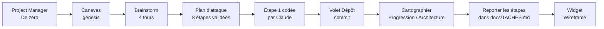

# Audit d'usage — parcours « nouveau projet de zéro » (2026-10-11)

> Test de l'app réelle par Claude, joué comme un utilisateur, de bout en bout. Objectif : voir ce qui marche, ce qui ne
> marche pas, ce qui peut être amélioré et ce qui est hors contexte comme mécanisme.

## 1. Conditions du test

| Élément | Valeur |
|---------|--------|
| Build | `electron-vite build` du commit `af72fb9` (main, propre) |
| Profil | fictif `gestionnaire-idees-e2e` (`--e2e`, `GI_E2E_EMPTY=1`), jamais le profil réel |
| Coffre | ProjectMaster fictif temporaire (`%TEMP%/gi-audit-coffre`), registre `/hub` vide au départ |
| Claude | **réel** (`claude -p` 2.1.296, abonnement) : Opus 5.5 pour le genesis, Sonnet 5.5 pour l'étape |
| Pilotage | Playwright relié à l'app (CDP), sans aucune touche envoyée à Windows ; vue de 1 600 × 950 px |
| Captures | `test-results/audit-2026-10-11/` (hors git), citées ci-dessous par leur numéro |

**Scénario joué** (un projet fictif « Carnet de rando », app web perso pour noter ses randonnées depuis des GPX) :

## 2. Verdict par étape

| # | Étape | Verdict | Résumé |
|---|-------|---------|--------|
| 1 | Créer un projet de zéro | ✅ marche | Formulaire clair, slug déduit, dossier + git + registre créés (01, 02) |
| 2 | Brainstorm avec Claude | ✅ marche, ⚠️ départ | Questions pertinentes, 10 à 20 s par tour, fiche et maturité tenues à jour ; mais le premier message envoyé n'est pas celui préparé (§4.1) |
| 3 | Plan d'attaque | ✅ marche, ⚠️ doublon | 8 étapes fantômes justes, « Tout valider » OK ; proposées deux fois (§5.2) |
| 4 | Faire coder une étape | ⚠️ partiel | Le code est écrit (10 fichiers sains), mais l'étape reste « À faire » et rien n'invite à la réaliser (§4.3, §5.3) |
| 5 | Commit par le volet Dépôt | ✅ marche | Message Conventional Commits proposé en 4 s, commit propre (18a, 19a) |
| 6 | Cartographier le projet | ✅ marche, ❌ cohérence | 26 éléments en 50 s ; mais le travail existe maintenant en trois exemplaires (§5.1) |
| 7 | Reporter les étapes en fichier | ✅ marche, ⚠️ suite manuelle | `docs/TACHES.md` créé, Workflow le lit ; il faut encore « Les retirer » à la main |
| 8 | Widget Wireframe | ✅ très bien | 5 écrans fidèles au brainstorm, réglages flottants, plein écran lisible (25a, 25b) |

## 3. Ce qui marche bien

1. **La qualité de Claude dans le brainstorm** : questions qui décident de la forme du produit (« sur le terrain ou de
   retour chez toi ? »), choix par défaut proposés pour la V1, rien d'inventé. La fiche du genesis est réécrite à
   chaque tour et la maturité passe de « brute » à « complet » au bon moment.
2. **Le Project Manager** : un seul écran pour créer un projet, avec CLAUDE.md, JOURNAL, `src/`, `tests/`, un dépôt git
   et l'entrée dans le registre `/hub`.
3. **Le plan d'attaque** : étapes numérotées, fantômes à valider une par une ou toutes d'un coup.
4. **Le volet Dépôt** : liste des fichiers modifiés, « Tout cocher », message proposé par Claude en 4 s et commit
   immédiat, avec le bon auteur.
5. **La cartographie** : bon diagnostic (« le SQL des routes est écrit directement dans `server/index.ts` », « pas de
   tests », « Leaflet absent »), statuts Livré / En cours / À faire déduits du code.
6. **Le widget Wireframe** : le meilleur moment du parcours. Les écrans reprennent les décisions du brainstorm (note
   sur 5, département déduit et corrigeable, saison tirée de la date, import en lot), le panneau de réglages change
   l'écran en direct, le plein écran rend la maquette lisible.
7. **Les demandes de permission** (mode « Demander ») : un encart « Claude demande à lancer une commande » avec
   Autoriser / Toujours pour ce projet / Refuser.

## 4. Ce qui ne marche pas (bugs)

| # | Gravité | Constat | Cause | Capture |
|---|---------|---------|-------|---------|
| 4.1 | Moyenne | « Commencer le brainstorm » envoie un message générique (« Commençons le brainstorm de cette idée. ») alors que le champ contient déjà la consigne du projet (« …Pose-moi d'abord les questions qui comptent, une à la fois »). Celle-ci est perdue et Claude pose deux questions par tour. | **Vérifiée** : `ChatPanel.tsx:683` envoie `OPENING_MESSAGE` sans regarder le brouillon prérempli par `brainstormPrompt` (spec 024 D8) | 04b |
| 4.2 | Moyenne | Le badge du dépôt affiche « main · à jour » alors que 10 fichiers ne sont pas commités ; il ne se corrige qu'à l'ouverture du volet. | Observée, non lue dans le code (pas de rafraîchissement après les écritures de Claude) | 18a |
| 4.3 | Moyenne | L'étape ① reste « À faire » alors que Claude l'a codée et commitée, et la cartographie la dit « Livré ». | Observée : seul `element_avancer` (éléments de structure) fait avancer un statut, rien pour une étape de plan | 17, 21 |
| 4.4 | Basse | Le compteur reste à « 1 brute · 0 en dév. · 0 éclose » après un brainstorm complet, un plan validé et une étape codée. La pastille « Idée brute » de la carte ne bouge pas non plus. | Observée (`CanvasToolbar.tsx:66` compte un état que rien n'a fait évoluer) | 12b, 21 |
| 4.5 | Basse | Liste des modèles datée : « Haiku 4.5 » proposé, Haiku 5.5 absent. | **Vérifiée** : `shared/ipc/ai.ts:4`, `ChatPanel.tsx:41`, `AiSettingsPage.tsx:11` | — |
| 4.6 | Basse | Le badge du dépôt et le nœud genesis, animés en continu, ne sont jamais « stables » pour un clic automatisé (Playwright doit forcer), et le raccourci Ctrl+Maj+G n'a rien ouvert sans nœud sélectionné. | Observée | — |
| 4.7 | Basse | Console : « The Content Security Policy directive 'frame-ancestors' is ignored when delivered via a `<meta>` element » à chaque widget. | **Vérifiée** : `frame-ancestors` dans la CSP `<meta>` de `index.html` et `capture.html`, sans effet à cet endroit | — |
| 4.8 | Info | Une commande de Claude est restée bloquée sans fin (`python3 -`, qui ouvre le raccourci du Microsoft Store sur ce PC). L'app affichait « Commande… en cours » sans durée ni alerte. | Cause hors app ; le manque d'indication, lui, est un défaut de l'app | 15 |

## 5. Ce qui est hors contexte ou incohérent comme mécanisme

### 5.1 Trois représentations du même travail, non synchronisées (le point principal)

À la fin du parcours, les 8 tâches du projet existent en **trois exemplaires** qui ne se parlent pas :

| Représentation | Où | Créée par | Statut de « Socle technique » |
|----------------|----|-----------|-------------------------------|
| Étapes du plan d'attaque | base de l'app | « Proposer un plan d'attaque » | **À faire** |
| Éléments de la carte de structure | base de l'app | « Cartographier ce projet » | **Livré** |
| Tâches d'un fichier Markdown | `docs/TACHES.md` | « Les reporter dans les fichiers » | **[x] livré** |

Ce que l'utilisateur voit :

1. Le projet s'ouvre sur l'onglet **Workflow** et le plan y naît (11) ;
2. après la cartographie, ces mêmes étapes y deviennent « 8 étapes générées masquées » (21-Workflow), à reporter
   dans un fichier ou à retirer ;
3. **Progression** et **Architecture** montrent 10 éléments qui recopient le plan sous d'autres noms (21) ;
4. avant la cartographie, les trois onglets affichaient exactement la même chose (20) : la bascule n'avait pas de sens.

**Recommandation** : une seule source de vérité pour « ce qu'il reste à faire ». Puisque D20–D23 ont fait des
fichiers de tâches la vérité de Workflow, le plan d'attaque d'un genesis **lié à un projet** devrait écrire directement
dans `docs/TACHES.md` (une étape = une tâche), sans passer par des étapes en base. La cartographie relierait ensuite ses
éléments à ces tâches au lieu d'en créer des doubles. À trancher dans une spec (amendement de 023 ou nouvelle spec).

### 5.2 Deux portes pour le plan d'attaque

Quand la maturité passe à « complet », Claude pose de lui-même le plan dans la conversation. Le bouton « Proposer un
plan d'attaque » le redemande ensuite, et Claude prévient lui-même : « tu verras peut-être les étapes en double : ne
valide qu'un seul des deux jeux ». L'app n'en a pas créé deux cette fois, mais l'utilisateur ne peut pas le savoir.
**Recommandation** : une fois un plan posé, le bouton devient « Revoir le plan » (ou disparaît).

### 5.3 Les boutons d'une étape ne correspondent pas à une étape

La conversation de l'étape ① propose **« Commencer le brainstorm »** et **« Proposer un plan d'attaque »**, mais rien
pour **réaliser** l'étape. Il a fallu écrire soi-même « Réalise cette étape… ». **Recommandation** : sur une étape, le
bouton principal est « Réaliser cette étape » (consigne figée : lire le plan, coder, tester, rendre compte, faire
avancer le statut) ; le brainstorm reste au genesis.

### 5.4 La conversation vit dans la carte

La carte de conversation est un nœud du canevas : elle s'ouvre en partie hors de l'écran (02, 03) ; « Recentrer »
zoome sur le genesis et la sort de l'écran (04c) ; « Tout afficher » l'ignore (05) ; dézoomée, elle devient illisible
(06), y compris l'encart d'autorisation d'une commande (14a). Pour la vue principale de travail avec Claude, c'est le
frein le plus visible. **Recommandation** : conversation dans un panneau fixe (à droite, redimensionnable) relié au nœud
sélectionné, comme le volet Dépôt, qui montre déjà le bon modèle (18a).

### 5.5 Une permission en attente ne se voit nulle part ailleurs

Pendant le report vers `docs/TACHES.md`, une demande « Autoriser » attendait dans la carte de conversation, hors du
champ de vision : le tour a semblé durer 198 s alors que l'app attendait un clic (cause signalée par mentalyas pendant
le test). Ni le nœud, ni la barre, ni « À valider » ne le montraient. **Recommandation** : une pastille « ⏸ attend ton
accord » sur le nœud et dans la barre du canevas, et une notification si la fenêtre n'a pas le focus.

### 5.6 Les écritures faites par Bash échappent au suivi

Claude a écrit tout le socle par `cat > fichier <<EOF` dans une seule commande Bash. Le suivi des écritures (livrable
d'une action finale, chemins d'un élément) ne repose que sur un hook `PreToolUse` limité aux outils d'écriture
(**vérifié** : `domain/conversation/hookSettings.ts:29`). Ces fichiers n'ont donc été vus par aucun suivi. Côté
permission, l'encart montrait une commande de plus de 150 lignes réduite à trois lignes : impossible de relire ce
qu'on autorise. **Recommandation** : demander à Claude, dans la consigne de la conversation, d'écrire les fichiers avec
les outils Write/Edit ; en filet, comparer `git status` avant et après le tour.

### 5.7 Petites incohérences de contexte

- **« Reprendre un projet existant »** est affiché dans la barre d'un projet qu'on vient de créer de zéro.
- **La barre Workflow / Progression / Architecture** flotte au-dessus du genesis, déborde à droite (« reconn… ») et
  à gauche en vue Workflow (21-Workflow) : c'est le défaut déjà noté au JOURNAL du 10/10, encore visible.
- **Le tutoiement change** : Opus tutoie dans le genesis, Sonnet vouvoie dans l'étape (même projet, même utilisateur).
- **La revue du widget** dit « ce widget ne reçoit rien tant que tu n'as pas autorisé cette version », alors que le
  wireframe affiche déjà le contenu de l'idée (Claude l'a reçu à la construction). Le message décrit le droit de
  lecture du code du widget, mais se lit comme « il n'a rien vu ». La fenêtre « Plus tard » qui s'ouvre au branchement
  n'explique pas non plus qu'elle est cette revue.
- **L'intégration `/hub` est partielle** : le registre est rempli, mais rien n'est écrit dans le JOURNAL global,
  aucune session n'est ouverte dans `sessions.json`, et `visibility: "local"` n'est pas une valeur du skill
  (`public | private`).
- **L'étiquette « Idées » dans l'en-tête** reste affichée dans le canevas d'un projet, et le nom du projet y apparaît
  deux fois.

## 6. Ce qui peut être amélioré (confort)

1. **Le plan est dessiné en chaîne** alors que Claude dit « les étapes 6 et 7 peuvent se faire dans n'importe quel
   ordre » : montrer les branches parallèles.
2. **« Tout afficher » rend les libellés illisibles** dès 8 étapes (11) : prévoir un zoom minimum lisible, ou replier
   par lots.
3. **Le widget naît loin du nœud branché** (23d : un long trait traverse la carte) : le poser à côté de lui.
4. **Après « Les reporter dans les fichiers »**, Claude dit « tu peux retirer les étapes de la carte » : l'app pourrait
   proposer le retrait dans la foulée (un clic, annulable).
5. **Une commande longue** devrait afficher sa durée et, au-delà d'un seuil, « toujours en cours… Arrêter ? ».

## 7. Priorités proposées

| Priorité | Sujet | Effort estimé | Section | État |
|----------|-------|---------------|---------|------|
| 1 | Une seule source de vérité pour les tâches (plan → fichier de tâches) | spec | §5.1, §5.2 | à spécifier |
| 2 | Conversation en panneau fixe hors du canevas | spec | §5.4, §5.5 | à spécifier |
| 3 | Bouton « Réaliser cette étape » et statut d'étape qui avance | moyen | §5.3, §4.3 | à faire |
| 4 | Bouton de départ qui envoie le brouillon préparé | petit | §4.1 | ✅ corrigé le 11/10 |
| 5 | Badge du dépôt rafraîchi après chaque tour de Claude | petit | §4.2 | ✅ corrigé le 11/10 |
| 6 | Pastille « attend ton accord » | petit | §5.5 | ✅ corrigé le 11/10 |
| 7 | Liste des modèles (Haiku 5.5), CSP `frame-ancestors`, bouton « Reprendre » hors contexte | petit | §4.5, §4.7, §5.7 | ✅ corrigé le 11/10 |

Corrections 4 à 7 vérifiées dans l'app réelle le 11/10 (profil et coffre fictifs, Claude réel) : premier message =
consigne du projet, aucune « Reprendre » sur le canevas, « Haiku 5.5 » proposé, pastille visible pendant une demande
puis retirée après « Autoriser », badge passé de « à jour » à « 1 modifié » à la fin du tour.

## 8. Limites de ce test

- Un seul scénario (de zéro), joué une fois. La reprise d'un projet existant, la capture rapide, les skills, le
  clonage, le push vers GitHub et le lancement du projet n'ont pas été joués.
- La vue de 1 600 × 950 px est émulée (la fenêtre de l'app ne se redimensionne pas par CDP) ; les débordements constatés
  existent aussi à la taille par défaut (02).
- Le code produit par Claude dans le projet fictif n'a pas été installé ni exécuté.
- Les causes marquées « observée » n'ont pas été lues dans le code : à confirmer avant correction.
