# Audit d'usage — mener un vrai projet, Bike_cycle (2026-10-12)

> Test de l'app réelle par Claude, joué comme un utilisateur, sur un projet existant né dans le Brainstormer :
> Bike_cycle (gestion et suivi de réparation de vélos pour un atelier). Objectif : mener le projet le plus loin
> possible dans l'app, relever à chaque pas les incohérences et faiblesses, proposer des améliorations, y compris des
> fonctionnalités nouvelles. Suite de l'audit du 11/10 (`AUDIT-2026-10-11-parcours-nouveau-projet.md`).

## 1. Conditions du test

| Élément | Valeur |
|---------|--------|
| Build | `electron-vite build` du commit `3ba93a4` (spec 027 livrée) |
| Profil | **réel**, à la demande de mentalyas (`%APPDATA%/gestionnaire-idees`) ; base et dossier sauvegardés avant le test (`%TEMP%/gi-sauvegarde-2026-10-12`) |
| Projet | `ProjectsMaster/bike-cycle`, dépôt au commit `b64fe9f` au départ ; projet marqué « de confiance » pour pouvoir le lancer (réversible dans Réglages) |
| Claude | **réel** (abonnement), Sonnet 5.5 pour les éléments ; permissions accordées une à une (mode « Demander ») |
| Pilotage | Playwright relié à l'app (CDP), aucune touche envoyée à Windows ; vue de 1 600 × 950 px ; le produit testé dans Edge sans fenêtre (bureau, tablette 1 280 × 800, smartphone 390 × 844) |
| Captures | `test-results/audit-2026-10-12-bike-cycle/` (hors git) |

## 2. Ce qui a été mené

```mermaid
flowchart LR
  A[Ouvrir Bike_cycle<br/>état des 3 vues] --> B[2.11 Tests de la base<br/>60 tests]
  B --> C[3.3 API de dépôt<br/>POST /api/depots]
  C --> D[Widget Wireframe<br/>écran comptoir]
  D --> E[4.3 PWA React<br/>dépôt + ticket QR]
  E --> F[Lancer API + PWA<br/>depuis l'app]
  F --> G[3.7 + 4.7 Suivi public<br/>/suivi/code]
  G --> H[3.4 + 4.4 Tablette<br/>atelier]
  H --> I[Boucle vérifiée<br/>tablette → client]
```

| # | Pas | Verdict | Résumé |
|---|-----|---------|--------|
| 1 | Ouvrir le projet | ⚠️ | Trois vérités différentes sur l'avancement (§3.1) ; genesis encore « Idée brute » |
| 2 | Tests de la base (2.11) | ✅ | 60 tests verts en 143 s, 3 permissions ; élément « faite », module 82 → 91 % |
| 3 | API de dépôt (3.3) | ✅ code, ⚠️ carte | `POST /api/depots` sans dépendance, 94 tests ; l'élément reste « en cours 90 % » après le commit |
| 4 | Wireframe de l'écran comptoir | ✅ widget, ❌ suite | 5 écrans fidèles en 217 s, réglages riches ; branchement laborieux ; **Claude ne peut pas le lire** pour coder (§3.2) |
| 5 | PWA React, écran comptoir (4.3) | ✅ | 96 + 22 tests, dépôt réel créé (201), ticket avec code et QR ; recherche client du wireframe absente |
| 6 | Lancer le projet | ✅, ⚠️ | API et PWA tournent depuis l'app ; 4 scripts à enchaîner à la main ; serveur périmé après modification |
| 7 | Suivi public (3.7 + 4.7) | ✅ code, ⚠️ carte | Route sans donnée personnelle, limitation des essais, page smartphone ; 3.7 non avançable par Claude |
| 8 | Tablette d'atelier (3.4 + 4.4) | ✅ code, ⚠️ carte | 5 colonnes, un geste par étape, file hors-ligne ; 138 + 51 tests ; 3.4 non avançable |
| 9 | Boucle de bout en bout | ✅ | Tablette « Passer au diagnostic » → la page du client affiche « diagnostic » |
| 10 | Commits (volet Dépôt) | ✅ | 6 commits, messages proposés justes en 5 s ; rien ne remonte vers la carte |

Commits sur `bike-cycle` (non poussés) : `adada34` correctif de l'identifiant du poste (§3.7), `3a15523` tests de la base, `38a4d7c` + `d76c7fa` API de dépôt (le premier ne
contient que les tests : erreur du script de test, pas de l'app), `53aa3b9` PWA et comptoir, `524f847` suivi public,
`8c06bf0` tablette et règles d'étapes.

**Le produit fonctionne** : de la saisie au comptoir au suivi par le client, en passant par l'atelier, sur une base
SQLite locale, sans dépendance côté serveur. **La carte, elle, ne dit plus la vérité** : c'est le constat central.

## 3. Constats

### 3.1 Avancement : la carte ne suit pas le travail (MAJEUR)

État en fin de test, pour le même travail :

| Source | Ce qu'elle dit |
|--------|----------------|
| Code et git | 6 fonctionnalités codées, testées, commitées |
| Progression (éléments) | 5 livrées ou faites ; 3.3 « en cours 90 % », 3.4 « à faire » (codés et commités) ; modules API et PWA « à faire » à 19 % et 43 % |
| Workflow (`docs/TASKS.md`) | **0 sur 26**, « Dépôt au comptoir », « Suivi tablette », « Page de suivi publique » « à faire » ; « Choix de la stack » à faire alors que la décision 1.1 est faite |
| Plan d'attaque | 28 étapes générées masquées, jamais à jour |
| Genesis | « Idée brute » (compteur « 1 brute · 0 éclose ») |

Causes relevées :

- **A10, A17** — règle de « livrée » flottante : un élément attend un commit qu'il ne voit jamais (le commit se fait
  dans le volet Dépôt), un autre se déclare livré avant tout commit, avec des manques.
- **A19** — rien ne coche le fichier de tâches quand un élément avance (aucun lien entre une tâche de `TASKS.md` et un
  élément).
- **A20** — `element_avancer` n'accepte qu'un identifiant et `structure_lire` ne renvoie que des clés : Claude ne peut
  faire avancer que l'élément de sa conversation, alors qu'une fonctionnalité en touche souvent deux (API + écran).
  Il a même pris l'identifiant d'une **étape du plan** homonyme, refusé (doublon de noms plan / éléments).
- **A24** — aucun moyen de changer le statut d'un élément à la main (la carte n'offre que sa couche) ; Claude conseille
  « passez-le à la main ».
- **A12, A28** — l'avancement d'un module est agrégé, pas son statut (« à faire » avec trois enfants livrés).
- **A27** — les fichiers d'un élément ne suivent pas ce que Claude écrit pour lui (3.7 livrée sans « contient du
  code »).
- **A7** — le résumé d'un élément est figé (« aucun test » alors que le fichier existe).

### 3.2 Le wireframe ne sert pas au code (MAJEUR)

- **A16** — Claude ne peut pas lire un widget (`noeud_lire` ne renvoie que son identifiant). Le wireframe branché sur
  l'élément 4.3 n'a pas été vu : l'écran a été codé d'après la description, sans la recherche de client existant ni le
  récapitulatif latéral du wireframe. Le maillon design → code de la spec 026 est coupé.
- **A14** — brancher un nœud sur un widget : la carte de détails couvre la zone, la poignée fait 5 px au zoom courant,
  l'échec est silencieux (le widget reste vide).
- **A15** — le widget naît à taille fixe sur la rangée de nœuds voisine (aucune place libre cherchée).

### 3.3 Le savoir du projet est éparpillé

- **A21** — la décision « Lecture publique restreinte » (tâche de `TASKS.md`, étape masquée) et la fiche RGPD (vide) ne
  sont pas lisibles depuis l'élément qui en a besoin.
- **A22** — Claude a repéré une contradiction de specs (code seul ou contact + code) : aucune place sur la carte pour
  une décision à trancher ; elle finit dans un message.
- **A25** — écart à la stack décidée (`localStorage` au lieu d'IndexedDB/Dexie) signalé par Claude, sans trace sur la
  décision 1.1, toujours « faite » sans réserve.

### 3.4 Lancer le projet

- **A18** — il faut enchaîner 4 scripts à la main (`seed:dev`, `web:install`, `start`, `web:dev`) ; pas de profil de
  lancement ; liste des scripts sans nom accessible ; pas de bouton « Ouvrir » pour l'adresse de Vite (5173).
- **A23** — après une modification du serveur par Claude, le processus continue sur l'ancien code (nouvelle route en
  404), sans signal.
- **A26** — les lancements terminés ou arrêtés s'empilent (7 lignes pour 2 processus).

### 3.5 Carte et panneau

- **A5, A13** — « Tout afficher » sur 46 nœuds : libellés illisibles, la barre des vues sort de l'écran ; « Centrer »
  garde ce zoom (nœud minuscule).
- **A9** — les onglets s'accumulent (6 en fin de test) ; ni « fermer les autres » ni fermeture des terminés.
- **A8** — la conversation vide d'un élément « à faire » propose « Commencer le brainstorm » (et parle de « l'idée ») ;
  le « Réaliser » des étapes (spec 013 D6) n'existe pas pour les éléments.
- **A6** — le bandeau JOURNAL et anomalies prend ~150 px en permanence.

### 3.6 Coffre ProjectMaster

- **A1** — « Coffre : ProjectsMaster · sans registre ProjectMaster » alors que `.hub/registry.json` existe ; Bike_cycle
  a été créé à la racine du coffre (pas dans `projects/`) et n'est pas au registre.
- **A2** — `gestionnaire-idees`, dans `projects/`, est présenté « Externe ».

### 3.7 Trouvé par mentalyas après le test

- **A29** (produit) — l'écran « Configurer ce poste » acceptait tout texte non vide ; l'API refusait seulement au moment
  d'enregistrer le dépôt (« utilisateur_id : UUID attendu »), sans moyen de changer l'identifiant. Le test scripté ne
  l'a pas vu (valeur exacte collée). Corrigé par l'app elle-même, dans la conversation de l'élément 4.3 (`adada34` :
  format vérifié et nettoyé, « Changer d'utilisateur », refus traduits) ; le serveur a de nouveau dû être relancé à la
  main (A23). Exemple type de ce que la recette par Claude (F5) doit attraper : jouer aussi les saisies maladroites.

### 3.8 Ce qui marche très bien

- Les conversations d'éléments produisent du code propre, testé, sans dépendance inutile, et **signalent leurs
  limites** (PIN absent, imprimante non testée, écart de stack, contradiction de specs).
- Les messages de commit proposés sont justes et mentionnent les réserves de sécurité.
- Le panneau fixe de la spec 027 tient : six conversations, Dépôt et lecteurs sans jamais dézoomer.
- Le widget Wireframe : 5 écrans fidèles au métier, réglages complets, plein écran lisible.
- Lancer depuis l'app : plusieurs scripts côte à côte, sortie lisible, « Ouvrir » sur l'API.

## 4. Propositions

### 4.1 Corrections (ce qui existe, à rendre cohérent)

| # | Proposition | Répond à |
|---|-------------|----------|
| C1 | **Une règle de « livrée » unique** : livrée = travail fait **et** commit qui contient ses fichiers. Le volet Dépôt, au commit, retrouve les éléments couverts par les fichiers commités (chemins des éléments) et propose de les passer « livrée » (case par élément, cochée d'office). | A10, A17 |
| C2 | **Statut manuel dans la carte d'un élément** (À faire, En cours, Livrée, Bloquée), marqué « par toi », annulable. | A24 |
| C3 | **Statut agrégé des modules** : en cours dès qu'un enfant l'est, livré quand tous le sont. | A12, A28 |
| C4 | **MCP : `structure_lire` renvoie les identifiants, `element_avancer` accepte un identifiant ou une clé**, et peut viser un autre élément du même genesis (écriture marquée par Claude, annulable). | A20 |
| C5 | **Chemins d'un élément tenus à jour** : les fichiers écrits pendant un tour de sa conversation (hooks Write/Edit, et Bash suivi par git) lui sont proposés. | A27 |
| C6 | **« Réaliser cet élément »** dans la conversation vide d'un élément à faire, comme les étapes (spec 013 D6). | A8 |
| C7 | **« Centrer » vise un zoom lisible** (au moins 0,8) ; « Tout afficher » garde la barre des vues à l'écran ; Progression passe à la ligne au-delà de 8 enfants. | A5, A13 |
| C8 | **Branchement vers un widget** : la carte de détails se ferme pendant le geste, poignée de taille fixe à l'écran, message en cas d'échec ; widget posé dans une place libre. | A14, A15 |
| C9 | **Lancer** : « Ouvrir » pour toute adresse détectée dans la sortie ; bandeau « Le code a changé depuis le lancement — Relancer » ; lancements terminés repliés ; nom accessible de la liste. | A18, A23, A26 |
| C10 | **Onglets** : « Fermer les autres », « Fermer les terminés » (menu de l'onglet). | A9 |
| C11 | **Coffre** : création dans `projects/`, entrée au registre `/hub`, détection du registre corrigée, projets du coffre jamais « Externes ». | A1, A2 |
| C12 | Résumé d'un élément relu à chaque fin de tour qui le touche ; genesis « éclos » dès que son projet existe ; bandeau JOURNAL repliable en une ligne. | A4, A6, A7 |

### 4.2 Fonctionnalités nouvelles

| # | Fonctionnalité | Pourquoi |
|---|----------------|----------|
| F1 | **Une seule source d'avancement** (suite de l'audit du 11/10 §5.1) : chaque tâche de `TASKS.md` est liée à un élément (clé stable dans le fichier, ex. `<!-- el:4.3 -->`) ; l'élément qui avance coche sa tâche, la tâche cochée fait avancer l'élément ; le plan d'attaque devient l'historique de la conception, plus une liste de travail. | A3, A19 : trois vérités aujourd'hui |
| F2 | **Widgets lisibles par Claude** : outil MCP `widget_lire` (écrans, réglages, état, HTML) et bouton « Réaliser d'après ce widget » dans un widget branché, qui ouvre la conversation de l'élément avec le wireframe en contexte. | A16 : le maillon design → code manque |
| F3 | **Décisions et questions ouvertes sur la carte** : Claude pose une « question à trancher » (MCP `question_poser`) ou signale un « écart à une décision » ; badge sur le nœud concerné, liste dans la carte du genesis, réponse en un clic qui met à jour la fiche. | A22, A25 |
| F4 | **Profils de lancement** : « Lancer l'app » enchaîne les scripts d'un profil (préparation une fois, puis API + PWA en parallèle), relance un processus quand ses fichiers changent. | A18, A23 |
| F5 | **Recette par Claude** (« Tester comme un utilisateur ») : sur un élément livré, Claude joue un scénario dans le produit lancé (navigateur piloté, captures) et rend un verdict sur la carte ; le scénario se déduit du wireframe ou du parcours du widget. | Ce test a montré que c'est le seul moyen de voir que la recherche client manquait |
| F6 | **Tableau de bord du projet** (carte du genesis) : avancement réel (éléments + tâches), tests verts, derniers commits, décisions ouvertes, processus lancés, prochain élément conseillé. | Savoir où on en est sans lire trois vues |
| F7 | **Fiches de référence liées** : une décision (stack, RGPD, lecture publique) épinglée comme « référence » d'un module ; ses éléments la reçoivent d'office dans leur contexte. | A21 ; remplace la règle écrite à la main dans le `CLAUDE.md` du projet |

### 4.3 Pour le produit Bike_cycle (hors Brainstormer)

À reprendre dans le projet : recherche d'un client existant et plusieurs vélos par dépôt au comptoir (wireframe),
clavier PIN à la place de l'identifiant configuré, choix « code seul » à confirmer dans la fiche RGPD, stockage local
IndexedDB/Dexie ou amendement de la décision de stack, service de `/suivi/*` par le serveur en production, test sur la
vraie imprimante 72 mm. Éléments 3.3 et 3.4 à passer « livrée » (codés et commités).

## 5. Priorités proposées

| Priorité | Contenu | Taille |
|----------|---------|--------|
| 1 | F1 + C1 + C4 : une seule source d'avancement, livrée au commit, MCP par clé | spec (brainstorm L1 d'abord) |
| 2 | F2 : widgets lisibles par Claude, « Réaliser d'après ce widget » | spec courte |
| 3 | C2, C3, C5, C6 : statut manuel, statut agrégé, chemins suivis, « Réaliser cet élément » | moyen |
| 4 | F3 : décisions et questions ouvertes | spec |
| 5 | C9 + F4 : lancement (Ouvrir, périmé, profils) | moyen |
| 6 | C7, C8, C10, C12 : finitions de la carte, des widgets et des onglets | petits |
| 7 | C11 : coffre et registre `/hub` | petit |
| 8 | F5, F6, F7 : recette par Claude, tableau de bord, fiches de référence | brainstorm |
