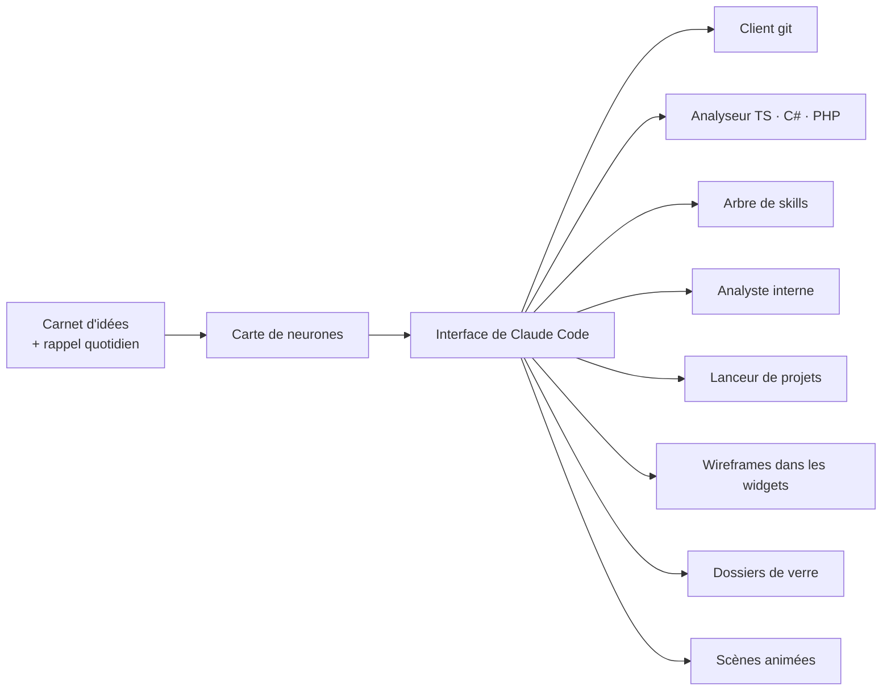

# Critique impartiale du Brainstormer — 2026-10-13

> **À lire avec Claude en début de prochaine session**, avant tout nouveau chantier.
> Demandée par mentalyas à la fin de la session du 12-13/10 : ce qui est utile, inutile, intelligent, à éviter,
> redondant, inefficace. Les chiffres sont relevés dans le dépôt le 13/10 ; ce qui reste une supposition est marqué
> **(à vérifier)**.

## Mesures

| Mesure | Valeur |
|---|---|
| Âge | 15 jours (28/09 → 13/10), 202 commits |
| Code source | ~75 000 lignes TypeScript |
| Tests | ~39 000 lignes, ~2 100 tests |
| Documentation (`docs/` + `specs/`) | ~40 000 lignes de Markdown : 91 fichiers de brainstorm, 101 notes de cours, journal de 1 500 lignes |
| Specs | 28 : **10 livrées**, 10 en pause, 5 en brouillon, 1 abandonnée, 1 en cours (029, ouverte le 13/10) |
| Migrations | 98 en 15 jours |
| Graphe graphify | 10 053 nœuds (au-delà de 5 000 : la vue HTML n'est plus régénérée) |

---

## 1. Intelligent

1. **Le pont MCP (Model Context Protocol)** : Claude écrit sur une carte visuelle, marqué « par Claude », annulable
   par lot. C'est l'idée originale du projet et sa vraie valeur.
2. **Sécurité au-dessus de la moyenne** : SQLite chiffré, Zod à chaque frontière IPC, aucun shell, widgets en iframe
   à origine opaque, secret du relais hors de `~/.claude.json`, test de confidentialité de bout en bout qui passe en
   revue tous les outils publics (3 fuites trouvées le 12/10).
3. **Historique annulable par lot** (journal avant/après) : c'est ce qui rend acceptable une IA qui écrit chez soi.
4. **Mesurer avant d'optimiser** : le banc sur 5 000 fichiers a montré un coût O(n²) ramené à O(n).
5. **Le cours académique**, cohérent avec l'apprentissage : comprendre après coup ce que l'IA a codé.

## 2. Utile

- Carte de structure, vue Workflow (spec 023 « Carte Workflow »), plan d'attaque (spec 011) : ils servent
  l'usage réel, **piloter un projet avec Claude**.
- Conversation en panneau fixe (spec 027), lancement d'un projet (spec 025).

## 3. Problèmes de fond

### 3.1 Le besoin d'origine a disparu

La description dit encore : *« noter vite fait à la main les idées du quotidien […] les structurer en tâches et
**recevoir un rappel chaque jour** »*. Aucun rappel quotidien planifié n'a été trouvé dans le code **(à vérifier)**.

Chaque branche se défend seule ; ensemble, elles font un **IDE incomplet**, plus un carnet d'idées.

### 3.2 Trop de chantiers ouverts

- 10 specs livrées contre 16 en pause, en brouillon ou en cours.
- Le 09/10, la règle était « fermer des chantiers avant la 024 ». Depuis : 025, 026, 027, 028, 029.
- **Spec 028 « Le dossier du nœud »** : brainstorm, spec, plan, 2 lots, 2 migrations… puis désactivée le jour même
  (« joli mais inutile »). On a construit avant de valider le besoin.
- **Spec 029 « Scènes animées de l'accueil »** (ouverte le 13/10) répète le schéma : un visuel de 21st.dev d'abord,
  le besoin ensuite.

### 3.3 Des outils existants reconstruits

| Fonction | Fait déjà mieux |
|---|---|
| Git et GitHub (spec 021) | VS Code, GitHub Desktop, `gh` |
| Analyse statique, explorateur (spec 017) | IDE, LSP, graphify |
| Arbre de skills (spec 020) | `~/.claude/skills`, `/skills` |
| Accueil ProjectMaster (spec 024) | le skill `/hub` |

Chacune est un produit à part entière ; en version partielle, elle coûte en maintenance sans battre l'original.

### 3.4 Le processus pèse plus que le produit

- **La documentation fait plus de la moitié du code** (~40 000 lignes contre ~75 000).
- Chaque fin de session : ~325 000 tokens pour le graphe, ~200 000 pour le cours.
- Le graphe (10 000 nœuds) n'est plus visualisable en HTML.
- **Statuts de spec désynchronisés**, ce qui fausse la vue Workflow qui les lit : 020 et 024 livrées selon
  `CLAUDE.md` mais « Draft » dans leur spec ; 010 « Décisions validées » alors que terminée.
- `CLAUDE.md` cite **Microsoft Graph + MSAL** dans la stack : aucune trace dans `src/` ni `package.json`.

## 4. Redondances

1. **Widgets éclatés sur 5 specs** (004, 005, 006, 015, 026), dont 2 en pause et 1 en brouillon.
2. **Quatre façons de rattacher du contenu à un nœud** : documents (012), dossier du nœud (028), fichiers couverts
   par la structure, fichiers écrits en conversation.
3. **Six vues d'un même projet** : structure, Progression, Architecture, Workflow, plan d'attaque, explorateur.
4. **Deux moteurs IA** (Ollama + Claude) alors que presque tout passe par Claude depuis la spec 010
   **(à vérifier : usage réel d'Ollama)**.
5. **Ancien moteur de neurones** : tables en archive et conversion au démarrage (code mort qui pèse).
6. **Anonymisation encore présente** (`src/main/domain/ai/anonymizationRules.ts`, utilisée par
   `src/main/domain/context/bundle.ts`) alors que la constitution 3.0.0 l'a retirée **(peut-être légitime pour
   l'export de contexte, à vérifier)**.

## 5. Inefficace

- **Fichiers trop gros** où tout se branche : `src/main/bootstrap.ts` (1 350 lignes),
  `src/renderer/src/canvas/IdeasCanvas.tsx` (1 071), `src/renderer/src/canvas/buildGraph.ts` (1 006).
- **98 migrations en 15 jours** pour une app mono-utilisateur : le schéma suit le rythme des idées.
- **E2e instables** (git-sync, widget-wireframe, workflow-task-files) : un test aléatoire finit ignoré.
- **La carte de Bike_cycle ne montre plus l'avancement** (`docs/AUDIT-2026-10-12-bike-cycle.md` §5) : la fonction
  centrale a régressé pendant qu'on construisait les à-côtés.

## 6. À éviter

- **Partir du visuel** (21st.dev) pour inventer une fonctionnalité. Ordre sain : problème vécu → solution → finition.
- **Une spec par idée** : Spec Kit cadre un chantier décidé ; une idée se note… dans le gestionnaire d'idées.
- **Lire « 2 100 tests verts » comme une preuve d'utilité** : ils prouvent que le code fait ce qu'il dit, pas qu'il
  sert (cf. spec 028).

---

## Verdict

Un cœur **excellent et original** (carte visuelle où Claude Code écrit, de façon sûre et annulable) et une
ingénierie solide, surtout en sécurité. Mais une **dispersion des fonctionnalités** et un **processus plus lourd que le
produit** : aujourd'hui, une démonstration de tout ce qu'on peut faire, plus qu'un outil ouvert chaque jour.

## Décisions prises le 2026-10-13

- [x] **Usage réel** : quatre usages gardés : carte + conversation Claude, piloter un projet, reprendre un projet
      existant, widgets et wireframes.
- [x] **Gel des fonctionnalités** jusqu'à : carte de Bike_cycle qui montre l'avancement + e2e stables (noté dans
      `CLAUDE.md`).
- [x] **Tri des specs** (une par une) : 021 « Git et GitHub » gardée, en pause jusqu'à la fin du gel et recentrée
      (commit, pull et push par Claude depuis le Brainstormer) ; 005, 011, 012, 013, 014, 015, 019, 022 redeviennent
      des idées ; 024 livrée (US1–US5), lot 7 abandonné ; 028 abandonnée (code retiré le 2026-11-12 s'il n'a pas
      resservi) ; 029 abandonnée, code sur la branche `archive/029-scenes-accueil`. 004, 008, 010, 016, 020 étaient
      finies : statut réaligné.
- [x] **Code mort** : Ollama sert encore (projets « Local uniquement », résumés Workflow, widgets) et
      l'anonymisation sert à l'import de contexte : gardés. Les tables d'archive de l'ancien moteur seront retirées
      dans un chantier à part après le gel (plan à valider : la migration efface des données).
- [x] **Fin de session allégée** : skill `/hub` modifié, avec un graphe au plus une fois par semaine (`/hub end --graph`
      pour le forcer) et le cours seulement après confirmation.
- [x] **Réaligner** : statuts des specs, `CLAUDE.md` (Microsoft Graph + MSAL retirés de la stack : absents du code).
- [x] **Besoin d'origine** : abandonné ; la description du projet est mise à jour (`CLAUDE.md`, registre `/hub`, GitHub).
