# Afficher un Markdown non fiable — arbre syntaxique, plugin remark et schéma Mermaid en image

> **En 30 secondes** — Un cours `.md` généré par Claude s'ouvrait en **texte brut numéroté**, et son schéma ```` ```mermaid ```` restait du code. Le 12/10, tout lecteur de `.md` s'ouvre **mis en forme** (brut en option), les encadrés `> [!NOTE]` deviennent des cadres colorés, et chaque bloc Mermaid devient un **dessin**. La difficulté n'est pas l'esthétique : ce texte vient **de l'extérieur** (Claude, un dépôt repris). Il faut le dessiner **sans jamais l'exécuter**.

```mermaid
flowchart LR
    T["texte .md<br/>(non fiable)"] --> P["remark : texte → mdast"]
    P --> G["remark-gfm<br/>tableaux, cases"]
    G --> C["remarkCallouts<br/>[!NOTE] → data-callout"]
    C --> H["mdast → hast<br/>skipHtml : HTML brut ignoré"]
    H --> R["composants React<br/>pre ? mermaid ?"]
    R -->|bloc mermaid| M["mermaid.render strict<br/>→ SVG (texte)"]
    M --> X["DOMParser HTML inerte<br/>→ XMLSerializer"]
    X --> I["balise img, src = data:image/svg+xml<br/>image : aucun script"]
```



---

## 1. Vue Macro & Utilité (le « Pourquoi »)

- **Problématique** : Markdown est un format **texte** qui décrit de la mise en forme. L'afficher, c'est le traduire en éléments d'écran. Mais Markdown accepte aussi du **HTML brut**, des liens, des images… et Mermaid produit un **SVG**, c'est-à-dire du balisage capable de porter des scripts ou des liens. Un `.md` piégé dans un projet repris pourrait viser l'interface de l'app, qui, elle, a accès au pont IPC (Inter-Process Communication — messages entre l'interface et le moteur).
- **Emplacement dans la carte globale** : **renderer** (couche présentation), composant partagé `Markdown.tsx` utilisé par les conversations, le lecteur des fichiers d'un élément, la visionneuse de livrables et la vue Workflow. Aucun canal IPC nouveau.
- **Analogie** (cuisine) : la recette (le `.md`) arrive d'un inconnu. Le cuisinier la **lit** pour dresser le plat (l'écran), mais n'**obéit** jamais à une ligne « ouvre la porte de la réserve » écrite dedans. Le schéma Mermaid, c'est une **photo du plat** collée sur la carte : on la voit, elle ne cuisine rien. Où l'analogie boite : la photo est fabriquée **par nous** (Mermaid tourne dans l'app) ; c'est le mode `strict` qui garantit qu'aucune instruction de la recette ne passe dans la photo.

## 2. Le Pont Systémique (sous le capot)

1. **Du texte à un arbre.** `react-markdown` s'appuie sur *unified* : le texte est d'abord analysé en **mdast** (*Markdown Abstract Syntax Tree*, arbre syntaxique abstrait de Markdown : chaque titre, citation, paragraphe est un **nœud** typé avec ses enfants). Les plugins **remark** transforment cet arbre. Puis il devient **hast** (même idée, pour le HTML) et chaque nœud hast est rendu par un composant React. Tout se passe **en RAM**, dans le processus renderer ; aucun HTML n'est assemblé en chaîne de caractères puis injecté.
2. **`skipHtml`.** Le HTML brut présent dans le `.md` (`<script>`, ``) est **ignoré** à la conversion : il n'arrive jamais dans le DOM (Document Object Model — l'arbre d'éléments que le navigateur dessine).
3. **Mermaid chargé à la demande.** `await import('mermaid')` : le bundler a mis Mermaid dans un **morceau séparé** (≈ 1,1 Mo) que le moteur JavaScript ne lit sur le disque qu'au premier schéma. Les conversations sans schéma ne paient rien.
4. **Le SVG devient une image.** `mermaid.render` rend une **chaîne** SVG. Au lieu de l'insérer dans la page (`innerHTML`), on l'encode en URL `data:image/svg+xml,…` et on la donne à un ``. Pour le navigateur, un SVG chargé **comme image** est un dessin statique : scripts désactivés, aucune ressource externe chargée, aucun accès à la page. La CSP (Content Security Policy — liste blanche des sources) de la fenêtre l'autorise déjà : `img-src 'self' data:`.
5. **Le piège XML.** Une image SVG doit être du **XML bien formé**. Mermaid met du HTML dans ses étiquettes (`<br>` sans fermeture), valide dans une page, **invalide** en XML : l'image ne se décodait pas (largeur naturelle 0). Correction : lire le SVG avec `DOMParser` en mode **HTML** dans un document **inerte** (rien n'y est exécuté ni chargé), puis le resérialiser avec `XMLSerializer`, qui ferme proprement chaque balise.

## 3. Analyse du Code & Logique

**Bloc 1 — un plugin remark, c'est une fonction qui parcourt l'arbre** (`src/renderer/src/chat/Markdown.tsx`)
```ts
const CALLOUT_MARK = /^\[!(note|tip|important|warning|caution)\][ \t]*\n?/i   // ① liste fermée de types

function remarkCallouts() {
  const visit = (node: MdNode): void => {
    if (node.type === 'blockquote') {                                         // ② seulement les citations
      const first = node.children?.[0]?.type === 'paragraph' ? node.children[0].children?.[0] : undefined
      const match = first?.type === 'text' ? CALLOUT_MARK.exec(first.value ?? '') : null
      if (first !== undefined && match !== null) {
        first.value = (first.value ?? '').slice(match[0].length)              // ③ la marque [!NOTE] est retirée
        node.data = { ...node.data, hProperties: { 'data-callout': (match[1] ?? '').toLowerCase() } }  // ④
      }
    }
    node.children?.forEach(visit)                                             // ⑤ parcours en profondeur
  }
  return (tree: MdNode): void => visit(tree)
}
```
- ① Seuls cinq types sont reconnus ; `[!FOO]` reste du texte (catalogue fermé → [[Glossaire — Union discriminée et catalogue fermé]]).
- ④ `hProperties` est la façon *unified* de dire « quand ce nœud deviendra HTML, ajoute cet attribut ». Le composant `blockquote` lit `data-callout` et choisit la couleur **parmi des jetons du thème** — le texte du fichier ne choisit jamais une classe CSS.
- ⑤ C'est un [[Glossaire — Parcours en profondeur (DFS)]] récursif. Pourquoi un plugin local plutôt qu'une dépendance ? 20 lignes, types réduits à l'utile, aucune surface nouvelle.

**Bloc 2 — reconnaître un bloc Mermaid sans regarder le texte brut.** Le composant `pre` reçoit le **nœud hast** : `mermaidSource` cherche un enfant `<code>` dont la classe contient `language-mermaid` et recolle ses textes. Sinon, `null` → bloc de code ordinaire.

**Bloc 3 — le dessin, en quatre garde-fous** (`MermaidDiagram.tsx`)
```ts
mermaid.initialize({ startOnLoad: false, securityLevel: 'strict', theme: dark ? 'dark' : 'default' })  // ①
const { svg } = await mermaid.render(id, source)
if (!alive) return                                                        // ② composant démonté entre-temps
setState({ kind: 'ready', src: `data:image/svg+xml;charset=utf-8,${encodeURIComponent(toXml(svg))}` })  // ③
// … erreur : le code source reste affiché, avec « Schéma Mermaid illisible : code source affiché. »   ④
```
- ① `strict` : Mermaid assainit les étiquettes et désactive les clics/scripts qu'il sait produire.
- ② Le drapeau `alive` évite d'écrire dans l'état d'un composant fermé (le rendu est asynchrone).
- ③ Image `data:` → aucune exécution, quoi que contienne le SVG (défense en profondeur : même si ① ratait quelque chose).
- ④ Dégradation honnête : un schéma invalide n'efface pas l'information, il la montre brute.

**Bloc 4 — le thème lu sur la couleur réelle.** `prefersDark` lit `--color-surface` et calcule sa **luminance** (`0,299 R + 0,587 V + 0,114 B < 128`) au lieu de tester le **nom** du thème : un thème « carbone » ajouté demain sera reconnu sombre sans changer ce code. Un `MutationObserver` sur `data-theme` redessine au changement.

> ⚠️ **Probable** — lu dans le code et le JOURNAL (test e2e `markdown-mermaid.e2e.ts` vert, `naturalWidth` vérifié dans l'app réelle), non exécuté ici. jsdom (le faux navigateur des tests unitaires) **ne décode pas les images** : seul l'e2e pouvait voir le défaut XML.

## 4. Synthèse & Prochaine Étape

**À retenir (3 puces max)**
- Un rendu Markdown sûr **transforme un arbre**, n'assemble jamais de HTML en texte ; le HTML brut du fichier est ignoré.
- Un SVG venu d'ailleurs s'affiche **en image** (``) : dessin statique, aucun script, aucun chargement.
- Un SVG valide **dans une page** n'est pas forcément du XML valide **en image** : resérialiser, puis vérifier dans l'app réelle.

**Lien avec la suite** : même réflexe « contenu non fiable » côté **sortie** : rien d'un projet « Local uniquement » ne doit partir vers Claude → [[Garde de confidentialité de bout en bout — garder par contenu, tester par énumération]].

**Rappel actif**
> **Q :** Pourquoi `` plutôt que `dangerouslySetInnerHTML={{ __html: svg }}` ?
> **R :** Inséré dans la page, le SVG fait partie du DOM : un `<script>`, un `onload` ou un lien qu'il contiendrait vivrait avec les droits de l'interface. Chargé comme image, le navigateur le traite en dessin statique.

> **Q :** Un `.md` contient `> [!DANGER] attention`. Que voit-on ?
> **R :** Une citation ordinaire avec le texte `[!DANGER] attention` : le type n'est pas dans la liste fermée, la marque n'est pas retirée.

> **Q :** Pourquoi lire le SVG en mode `text/html` puis le resérialiser en XML ?
> **R :** Le parseur HTML tolère `<br>` sans fermeture ; `XMLSerializer` réécrit l'arbre en XML bien formé, la seule forme qu'un décodeur d'image accepte.

**Pièges fréquents**
- ⚠️ **Tester un rendu d'image en unitaire** — jsdom ne décode rien ; vérifier `naturalWidth > 0` en e2e.
- ⚠️ **Choisir le style d'après le texte du fichier** — le fichier ne doit fournir qu'un **type** reconnu, l'app choisit les classes.
- ⚠️ **Charger une grosse dépendance au démarrage** — `import()` dynamique : on ne paie que si un schéma est affiché.

**Connexions**
- [[Glossaire — CSP (Content Security Policy)]] — `img-src data:` rend l'image possible, sans ouvrir `script-src`.
- [[Bac à sable des widgets — iframe isolée, origine opaque et protocole gi-widget]] — l'autre façon d'afficher du contenu actif : l'enfermer plutôt que le figer.
- [[Tests de bout en bout — Playwright pilote Electron sur un profil fictif]] — là où le défaut a été vu.
