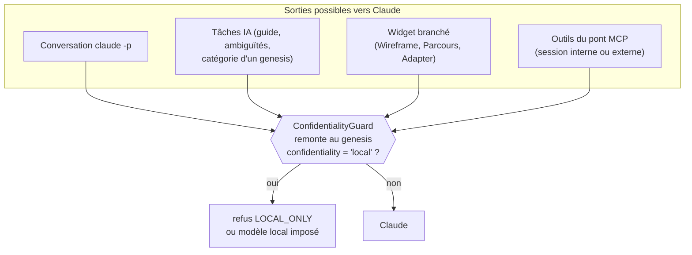

# Garde de confidentialité de bout en bout — garder par contenu, tester par énumération

> **En 30 secondes** — Un projet repris peut être marqué **« Local uniquement »** : rien de lui ne doit partir vers Claude (seulement vers le modèle local, Ollama). La promesse existait depuis le 07/10, gardée **outil par outil**. Le 12/10, un test l'a vérifiée sur **tout le parcours** (import, analyse, guide, carte, widget, conversation, chaque outil du pont MCP), avec un projet **piégé**. Il a trouvé **trois fuites réelles**. Les deux leçons : une garde doit regarder **ce que contiennent** les arguments, pas une liste de noms ; et un test de sécurité doit **énumérer ce qui existe**, pour échouer tout seul quand on ajoute un outil.



---

## 1. Vue Macro & Utilité (le « Pourquoi »)

- **Problématique** : la confidentialité d'un projet n'est pas une fonction, c'est une **propriété du système entier**. Une seule porte oubliée suffit à la casser. Or les portes se multiplient à chaque spec (widgets branchés, outils MCP nouveaux, catégorisation automatique…). Des tests unitaires par porte prouvent que **chaque garde fonctionne**, pas qu'**aucune porte n'en manque**.
- **Emplacement dans la carte globale** : processus **main**, couche *application* (`ConfidentialityGuard`, services qui appellent l'IA), et frontière avec Claude Code (pont MCP). Le test est un test d'**intégration** (services réels, base réelle, Claude simulé), pas un e2e.
- **Analogie** (électricité) : chaque prise de la maison a son **disjoncteur** (les gardes par service). Le contrôle de l'installation ne teste pas un disjoncteur à la fois : il **coupe le compteur général côté Claude** et branche un appareil sur **chaque prise du plan**. Si le plan oublie une prise, l'électricien refuse le certificat. Où l'analogie boite : ici le « plan » est généré par le code lui-même (`MCP_PUBLIC_TOOL_NAMES`), il ne peut pas être en retard sur la maison.

## 2. Le Pont Systémique (sous le capot)

1. **Remonter au projet.** Tout nœud (genesis, élément, étape) a un `rootId` / `genesisId` en base SQLite. `projectOf(neuronId)` lit cette ligne puis la ligne du projet repris : `confidentiality: 'claude' | 'local'`. Deux lectures indexées, en mémoire du main, à chaque appel sortant.
2. **Où « sortir » se passe physiquement.** Vers Claude, il n'y a que deux chemins : un **processus enfant** `claude -p` (conversation, tâches) et la **passerelle IA** (`AIGateway`, moteur Claude). Le test **intercepte les deux** (`t.h.claude.requests`, liste `spawned`) : si une seule requête y apparaît, échec. On mesure à la **sortie**, pas aux intentions.
3. **Le pont MCP, porte la plus large.** Claude Code (interne ou une **session externe** sans nœud) appelle des outils par le canal nommé. Les arguments sont validés par Zod, puis `guardTools` les inspecte **avant** l'exécution : tout identifiant trouvé, et l'appelant, sont remontés au projet.
4. **Le projet piégé.** Le dossier contient un `.env`, un `node_modules/.bin`, un hook git, un `core.fsmonitor` et un filtre `clean` qui écriraient un **fichier témoin** s'ils s'exécutaient. Le test vérifie l'absence des témoins : la confidentialité inclut « ne rien **lancer** du projet ».

## 3. Analyse du Code & Logique

**Bloc 1 — les trois fuites trouvées (JOURNAL 21:20)**

| Fuite | Pourquoi elle passait | Correction |
|---|---|---|
| Widget branché sur un nœud du projet → contexte complet envoyé à Claude | Le widget est une fonction **plus récente** (spec 026) que la garde | `localOnly` imposé à la génération (`WidgetService`, `WidgetIoService`) |
| Pont MCP : `element_avancer`, `dessiner`, `widget_poser` modifiaient le projet | La garde ne lisait que `id`, `projet`, `document` ; ces outils utilisent `element`, `ancre`, `parent`… | Garde **par contenu** (bloc 2) |
| Genesis d'une reprise catégorisé avant que sa confidentialité soit enregistrée | **Ordre** des opérations : repli vers Claude possible pendant une fenêtre | Pas de catégorisation, modèle local imposé (`NeuronService.localOnly`) |

**Bloc 2 — garder par ce que les arguments contiennent** (`ConfidentialityGuard.ts`)
```ts
const UUID = /[0-9a-f]{8}-[0-9a-f]{4}-[0-9a-f]{4}-[0-9a-f]{4}-[0-9a-f]{12}/gi

function uuidsIn(value: unknown, found = new Set<string>(), depth = 0): Set<string> {
  if (typeof value === 'string') {
    for (const match of value.matchAll(UUID)) found.add(match[0].toLowerCase())   // ① dans tout texte (clés wf:…)
  } else if (typeof value === 'object' && value !== null && depth < 8) {          // ② profondeur bornée
    for (const item of Array.isArray(value) ? value : Object.values(value)) uuidsIn(item, found, depth + 1)
  }
  return found
}
```
- ① Un identifiant caché dans une chaîne composée (`wf:<uuid>:docs/x.md`) est trouvé quand même.
- ② Récursion bornée à 8 niveaux : des arguments déjà validés par Zod, mais on ne fait jamais confiance à une profondeur.
- Effet : **un champ ajouté demain** à un outil est gardé sans que personne y pense. On passe d'une **liste blanche de champs** (qui vieillit) à une **règle sur la forme** de la donnée.
- Prix : un faux positif possible (un UUID cité dans un texte libre, qui serait celui d'un nœud local) → refus. Choix assumé : en sécurité, **refuser à tort** vaut mieux que **laisser passer à tort**.

**Bloc 3 — tester par énumération** (`local-only-end-to-end.test.ts`)
```ts
const calls = argumentsFor(ids, local.document)
// Tout outil public du pont est couvert : un outil ajouté sans cas ici fait échouer le test.
expect(Object.keys(calls).sort()).toEqual([...MCP_PUBLIC_TOOL_NAMES].sort())   // ①
for (const caller of [null, open.genesis, ...ids]) {                            // ② trois sortes d'appelants
  for (const [tool, variants] of Object.entries(calls)) {
    for (const args of variants) { /* appel → aucune fuite, aucun appel accepté qui vise le projet */ }
  }
}
```
- ① La liste des outils vient **du code** (`MCP_PUBLIC_TOOL_NAMES`) : un outil de plus sans cas de test = test rouge.
- ② Produit cartésien appelants × outils × variantes d'arguments (l'identifiant local à **chaque** place possible). Deux réglages de l'IA (`describe.each`) : modèle local en marche, et modèle local arrêté **avec repli vers Claude autorisé** — le cas le plus tentant pour une fuite.

> ⚠️ **Probable** — lu dans le code, le test et `specs/017-reprise-voir/research.md` (R10), non exécuté ici. Le test simule Claude : il prouve que **rien n'est demandé** à Claude, ce qui est exactement la propriété voulue.

## 4. Synthèse & Prochaine Étape

**À retenir (3 puces max)**
- Une propriété **transverse** (confidentialité) se vérifie sur le **parcours entier**, en observant les **sorties** réelles.
- Une garde qui énumère des **noms de champs** se périme au premier champ ajouté ; garder par **contenu** (tout identifiant).
- Un test de sécurité **énumère ce que le code déclare** (tous les outils) pour échouer quand on en ajoute un.

**Lien avec la suite** : le même jour, l'autre moitié de T035–T036 : mesurer l'analyse sur 5 000 fichiers → [[Mesurer puis désengorger le main — banc par phases, bornes, différences et tranches]].

**Rappel actif**
> **Q :** Pourquoi les trois fuites n'avaient-elles pas été vues par les tests existants ?
> **R :** Chaque test vérifiait **sa** garde ; aucun ne vérifiait qu'une fonction plus récente (widget branché), un champ nouveau (`element`) ou un **ordre** d'opérations (catégorie avant confidentialité) passait par une garde.

> **Q :** Que se passe-t-il si quelqu'un ajoute l'outil MCP `dossier_lire` sans toucher au test ?
> **R :** `Object.keys(calls)` ne contient pas `dossier_lire` alors que `MCP_PUBLIC_TOOL_NAMES` le contient : l'égalité échoue, le test est rouge.

> **Q :** Pourquoi tester le réglage « modèle local arrêté, repli vers Claude autorisé » ?
> **R :** C'est là que la passerelle choisirait Claude si personne ne lui disait `localOnly` : le seul réglage où un oubli devient une fuite.

**Pièges fréquents**
- ⚠️ **Tester la garde au lieu de la sortie** — on veut prouver « rien n'est parti », pas « la fonction a dit non ».
- ⚠️ **Lister à la main les cas d'un test de couverture** — la liste vieillit ; la tirer du code.
- ⚠️ **Oublier l'ordre** — une donnée encore « sans confidentialité » pendant quelques millisecondes est une fenêtre de fuite.

**Connexions**
- [[Glossaire — Principe du moindre privilège]] — imposer `localOnly` retire le choix de Claude au lieu de l'interdire après coup.
- [[Glossaire — Préoccupation transverse (point unique et tee)]] — même famille : un point par où tout passe.
- [[Glossaire — Expression régulière]] — la forme d'un UUID comme règle de détection.
- [[Lancer un programme sans shell — chemin absolu, arguments séparés, listes blanches]] — pourquoi aucun piège git du projet ne s'exécute.
