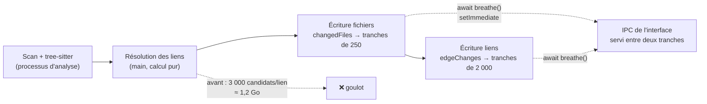

# Mesurer puis désengorger le main — banc par phases, bornes, différences et tranches

> **En 30 secondes** — La spec 017 promettait : analyse de 5 000 fichiers **< 2 min**, réanalyse **< 10 s**, app **utilisable pendant l'analyse**. Personne ne l'avait mesuré. Un **banc** e2e (projet généré TS + C# + PHP, importé par l'interface) a donné les chiffres, **phase par phase**. Le coupable n'était pas l'analyse syntaxique mais l'**écriture** : ≈ 1,2 Go de « cibles possibles » écrites à chaque analyse. Quatre corrections : **borner** (20 candidats), n'écrire que les **différences**, écrire **par tranches** en rendant la main, remplacer deux boucles **quadratiques** par des index. Résultat : 42,9 s, réanalyse 3,6 s, main à 6 ms au 95ᵉ centile.



---

## 1. Vue Macro & Utilité (le « Pourquoi »)

- **Problématique** : une promesse de performance non mesurée est une **supposition**. Et « app utilisable pendant l'analyse » dépend d'un seul fil : le **main** d'Electron sert **tous** les appels IPC de l'interface ; s'il calcule 3 s d'affilée, chaque clic attend 3 s.
- **Emplacement dans la carte globale** : processus **main** (`AnalysisService`, `CodeGraphRepository`, `domain/reprise/resolve.ts`) et **base** SQLite chiffrée ; le banc vit dans `tests/e2e/` ; la même idée se retrouve dans le **renderer** (peinture des illustrations).
- **Analogie** (Satisfactory) : l'usine produit trop lentement. Le débutant rajoute des foreuses (« l'analyse syntaxique doit être lente »). Le joueur expérimenté pose un **compteur sur chaque convoyeur** : le goulot est le **tapis de sortie** vers l'entrepôt (l'écriture en base), saturé par une pièce inutile produite en masse (les 3 000 candidats). On **filtre** la pièce, on n'envoie à l'entrepôt que ce qui a **changé**, et on fait passer les colis **par paquets** pour que le tapis de l'atelier voisin (l'IPC) avance aussi.

## 2. Le Pont Systémique (sous le capot)

1. **Un seul fil pour le JavaScript du main.** Node exécute le JavaScript sur **un fil** (thread) avec une **boucle d'événements** : une file de tâches (réponse IPC, fin de lecture disque, minuteur) traitées **une à la fois, jusqu'au bout**. Une fonction synchrone de 3,6 s = 3,6 s pendant lesquelles aucune autre tâche ne passe → [[Glossaire — Boucle d'événements (synchrone, asynchrone, céder la main)]].
2. **`setImmediate`, la respiration.** `await new Promise((done) => setImmediate(done))` termine la tâche courante et se remet **au bout de la file** : les messages IPC arrivés entre-temps passent devant. Coût : quelques microsecondes. Pire bloc restant : 1,6 s (la résolution des liens, calcul pur en mémoire).
3. **Le disque et la base.** `better-sqlite3` est **synchrone** : une transaction de 37 901 liens bloque le fil le temps d'écrire. Par tranches (250 fichiers ou 2 000 liens, **une transaction chacune**), chaque bloc tient en une fraction de seconde. Contrepartie : l'écriture totale n'est plus **atomique** ; une analyse interrompue laisse un graphe partiel, réécrit à la prochaine (les différences le rattrapent).
4. **Écrire moins.** Chaque ligne écrite dans une base **chiffrée** coûte chiffrement + journal + index. Comparer d'abord (lecture, une empreinte par ligne) puis n'écrire que les lignes qui diffèrent : la réanalyse après une modification d'un fichier passe de « tout réécrire » à quelques lignes.
5. **Même idée côté interface.** La file de peinture des dossiers (spec 028) dépense **6 ms par image** au plus (`PAINT_BUDGET_MS`) via `requestAnimationFrame`, puis rend la main au navigateur pour dessiner : 60 images/s ≈ 16,7 ms par image, il en reste ≈ 10 pour le reste.

## 3. Analyse du Code & Logique

**Bloc 1 — le banc : un projet fictif, déterministe, mesuré dans l'app réelle.** `tests/support/benchProject.ts` génère 5 002 fichiers (3 000 TS en 10 paquets npm, 1 251 C# en 5 projets .NET, 751 PHP PSR-4) qui **s'importent et s'appellent** : 31 502 symboles, 37 901 liens. `reprise-bench.e2e.ts` l'importe **par l'interface** et mesure : durée totale, aller-retour IPC pendant l'analyse (centiles), temps par image. Les résultats bruts vont dans `test-results/e2e/reprise-bench.json` (`research.md` R9).

**Bloc 2 — borner une donnée « pour l'IA »** (`domain/reprise/resolve.ts`)
```ts
export const MAX_CANDIDATES = 20
// lien incertain : au-delà de 20 cibles de même nom, aucune liste à trancher
candidates: result.found.length > MAX_CANDIDATES ? [] : result.found.map((symbol) => symbol.id)
```
Un appel `Run()` ou `handle()` avait jusqu'à **3 000** cibles possibles, ≈ 90 Ko par lien. Personne (ni l'IA, ni mentalyas) ne tranche sur 3 000 choix : la liste ne servait à rien et coûtait 28 s sur 37. Le lien reste « incertain », sa raison garde le **nombre**.

**Bloc 3 — n'écrire que les différences** (`CodeGraphRepository.edgeChanges`)
```ts
const stored = new Map(this.edges(genesisId).map((edge) => [edge.id, fingerprint(edge)] as const))  // ① base
const next = new Set(edges.map((edge) => edge.id))
return {
  remove: [...stored.keys()].filter((id) => !next.has(id)),                              // ② disparus
  write: edges.filter((edge) => stored.get(edge.id) !== fingerprint({ candidatesJson: null, ...edge }))  // ③ nouveaux ou changés
}
```
- ① On compare à la **base**, pas à une copie en mémoire : le comportement reste identique (un lien précisé par l'IA redevient incertain à la réanalyse, comme avant).
- Les identifiants de lien sont **stables** (dérivés du contenu), sinon aucune comparaison n'aurait de sens → [[Glossaire — Clé stable et upsert]].

**Bloc 4 — tranches et respiration** (`AnalysisService.write`)
```ts
const changed = this.deps.graph.changedFiles(genesisId, analyzed)
for (let start = 0; start < changed.length; start += FILES_PER_WRITE) {     // 250
  this.deps.graph.writeFiles(genesisId, changed.slice(start, start + FILES_PER_WRITE))  // une transaction
  await breathe()                                                            // setImmediate
}
```

**Bloc 5 — deux boucles quadratiques.** `entries.filter(e => pathOf.get(e.symbolId)?.path === file.path)` **dans** une boucle sur les fichiers = fichiers × points d'entrée comparaisons (5 000 × N). Remplacé par une `Map` construite une fois (`entriesOf`) : une lecture par fichier. Idem `code.some(...)` → `Set`. C'est le passage de O(n²) (le travail croît comme le carré de la taille) à O(n).

**Bloc 6 — la même maladie ailleurs : `workflow:read`.** L'Analyste interne a proposé, et mentalyas a gardé (fusion `fabab92`), une version **asynchrone** de la lecture des fichiers de méthode : `readProjectTextAsync` reprend **exactement** les protections de `readProjectText` (chemin réel sous la racine, fichier sensible refusé, taille bornée, binaire refusé), factorisées en petites fonctions partagées, mais avec `fs/promises` : pendant que le disque lit, le main sert l'interface.

> ⚠️ **Probable** — chiffres tirés de `research.md` R9 et du JOURNAL (mesurés sur le poste de mentalyas, non refaits ici). Le titre du commit de l'Analyste (« la correction notée appliquée est absente ») indique qu'une correction précédente avait été **déclarée** sans être dans le code : la mesure et la relecture l'ont rattrapée.

## 4. Synthèse & Prochaine Étape

**À retenir (3 puces max)**
- **Mesurer par phase avant d'optimiser** : le goulot était l'écriture, pas l'analyse.
- Une donnée « pour l'IA » **sans borne** finit par coûter plus que tout le reste ; n'écrire que les **différences**.
- Le main n'a qu'un fil : découper en **tranches** et **céder la main** (`setImmediate`, I/O asynchrones, budget par image côté interface).

**Lien avec la suite** : relire [[Explorateur de code — du module au bloc, appelants et appelés]] en sachant ce que coûte chaque lien incertain, puis [[Lever les ambiguïtés du graphe d'appels — l'IA choisit dans une liste fermée, le code vérifie]] : ses lots de 50 ne reçoivent plus jamais une liste de 3 000.

**Rappel actif**
> **Q :** Pourquoi découper l'écriture en tranches ne rend-il **pas** l'analyse plus rapide, et pourquoi le fait-on quand même ?
> **R :** Le travail total est le même (un peu plus, même). Mais entre deux tranches, la boucle d'événements traite les messages IPC : l'interface répond (6 ms au 95ᵉ centile) au lieu d'attendre 3,6 s.

> **Q :** Quelle propriété perd-on en passant d'une grande transaction à des tranches ? Pourquoi est-ce acceptable ici ?
> **R :** L'atomicité globale : une analyse interrompue laisse un graphe partiel. Acceptable parce que le graphe est une **donnée dérivée** des fichiers : la prochaine analyse recalcule et écrit les différences.

> **Q :** Repère la complexité : `for (file of files) entries.filter(e => e.path === file.path)`. Comment la réduire ?
> **R :** O(fichiers × entrées). Construire une fois `Map<path, entry[]>` puis lire `map.get(file.path)` : O(fichiers + entrées).

**Pièges fréquents**
- ⚠️ **Optimiser à l'intuition** — on aurait accéléré tree-sitter pour rien.
- ⚠️ **Mesurer hors de l'app réelle** — le main d'Electron sert aussi l'IPC ; seul le banc e2e voit le blocage ressenti.
- ⚠️ **`readFileSync` dans un gestionnaire IPC** — rapide sur un petit fichier, bloquant sur un disque lent ou réseau ; préférer `fs/promises`.

**Connexions**
- [[Glossaire — File et écriture par lots (batching)]] — l'inverse complémentaire : regrouper beaucoup de petites écritures en une ; ici, couper une énorme en plusieurs.
- [[Glossaire — Donnée dérivée (calculer plutôt que stocker)]] — pourquoi un graphe partiel n'est pas grave.
- [[Analyste en lecture seule — moindre privilège et propositions vérifiées]] — d'où vient la correction de `workflow:read`.
- [[Vue Workflow — l'état lu dans les fichiers, parseur ligne à ligne et clés stables]] — la vue qui lit désormais sans bloquer.
