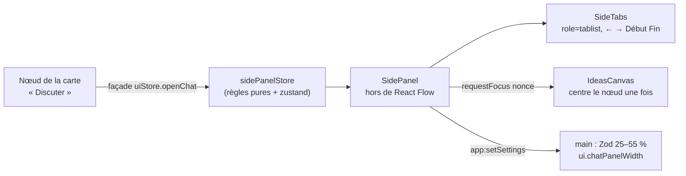
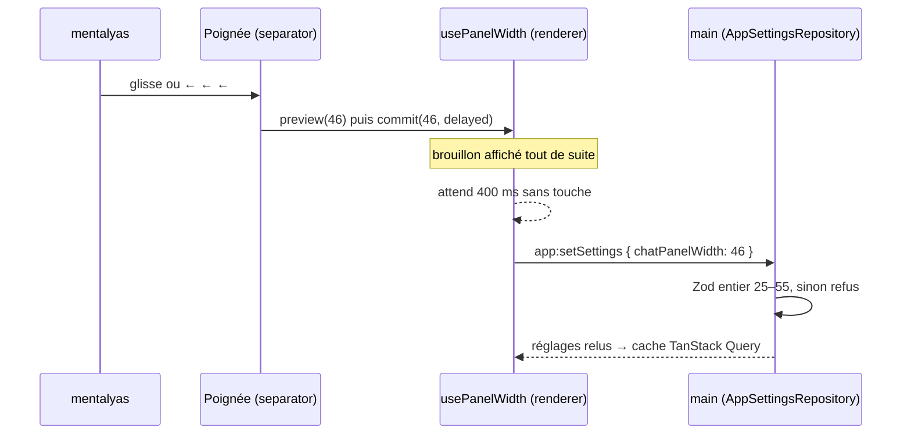

# Panneau fixe à onglets — une source de vérité, règles pures et façade gardée

> **En 30 secondes** — Jusqu'au 11/10, la conversation d'un nœud s'ouvrait **dans la carte** (à droite de sa carte de détails) : elle zoomait, glissait et passait sous les autres nœuds avec elle. L'audit d'usage l'a classée priorité 2. La spec 027 la sort dans un **panneau fixe à onglets**, à droite de l'écran, hors de React Flow. Trois idées de conception : **une seule source de vérité** (`sidePanelStore`), écrite en **fonctions pures** testées puis emballée dans Zustand ; des **façades** dans `uiStore` pour que les dizaines d'appelants ne changent pas ; et des **demandes** (centrer, enregistrer la largeur) que d'autres parties exécutent, une fois chacune.



---

## 1. Vue Macro & Utilité (le « Pourquoi »)

- **Problématique** : sur une carte zoomable, tout ce qui est **dans** la carte subit le zoom. Dézoomer pour voir le projet rendait la conversation illisible ; la faire glisser la sortait de l'écran. Et l'état « quelle conversation est ouverte » vivait à deux endroits (`cardsStore.side`, `cardsStore.reader`) qui pouvaient se contredire. Le constat d'audit : « aucune étape ne doit demander de dézoomer pour atteindre la conversation » (critère SC-005).
- **Emplacement dans la carte globale** : **renderer** seulement — couche présentation. Aucun nouveau canal IPC pour les onglets ; un seul champ de réglage nouveau (`chatPanelWidth`) passe par le canal existant `app:setSettings`, validé dans le main.
- **Analogie** (restauration) : avant, chaque bon de commande était **scotché sur l'assiette** — il partait avec elle en salle. Le panneau, c'est le **rail à bons de la passe** : fixé au mur, un bon par table (un onglet par conversation), le chef voit lesquels attendent (⏸) ou sont en cuisson (●). Retirer une assiette (fermer la carte) ne jette pas son bon. Où l'analogie boite : un onglet se ferme **tout seul** si son nœud disparaît — un rail de restaurant ne sait pas qu'une table est partie.

## 2. Le Pont Systémique (sous le capot)

1. **Deux couches de dessin.** React Flow dessine la carte dans un conteneur auquel il applique une **transformation CSS** (`translate` + `scale`) : c'est le processeur graphique qui la recalcule à chaque zoom. Le panneau est un frère de ce conteneur dans `IdeasPage`, pas un enfant : la transformation ne l'atteint pas. C'est toute la correction de SC-001 (« panneau identique au pixel près après 6 dézooms »).
2. **Un état, en RAM, observé.** `useSidePanel` est un magasin Zustand : un objet `{ tabs, shownKey, focus }` + des abonnés. Chaque action fait `set((state) => openChat(state, input))` : la **règle pure** reçoit l'ancien état, rend le nouveau (immuable), Zustand prévient les composants dont le sélecteur a changé.
3. **Le miroir de la façade.** `uiStore` s'**abonne** au panneau (`useSidePanel.subscribe`) et recopie deux valeurs **dérivées** (`chatNeuronId`, `repoGenesisId`) pour les anciens lecteurs. Une seule écriture (le panneau), une copie en lecture seule — pas deux vérités.
4. **La largeur jusqu'au disque.** Pendant un glissement, la largeur est un **brouillon** local (`draft`) ; au lâcher (ou 400 ms après la dernière flèche), un seul `app:setSettings` part vers le main, qui la valide (`z.number().int().min(25).max(55)`) avant de l'écrire dans la table de réglages chiffrée. Pas de `localStorage` : le renderer ne décide pas seul de ce qui est stocké.



## 3. Analyse du Code & Logique

```ts
// src/renderer/src/canvas/side/sidePanelStore.ts — une règle pure (testable sans React)
function add(state: SidePanelState, tab: SideTab): SidePanelState {
  const exists = state.tabs.some((entry) => entry.key === tab.key)       // ① pas de doublon : la clé = id du nœud
  return { ...state, tabs: exists ? state.tabs : [...state.tabs, tab], shownKey: tab.key }  // ② nouvel objet
}

export function close(state: SidePanelState, key: string): SidePanelState {
  const index = state.tabs.findIndex((tab) => tab.key === key)
  if (index === -1) return state
  const tabs = state.tabs.filter((tab) => tab.key !== key)
  if (state.shownKey !== key) return { ...state, tabs }
  const neighbour = tabs[index] ?? tabs[index - 1]                       // ③ voisin de droite, sinon de gauche
  return { ...state, tabs, shownKey: neighbour?.key ?? null }
}

// ④ le magasin n'est qu'un emballage : chaque action appelle la règle
export const useSidePanel = create<SidePanelStore>()((set) => ({
  ...EMPTY_SIDE_PANEL,
  close: (key) => set((state) => close(state, key)),
  /* … */
}))
```

- **Étape 1 — Union discriminée d'onglets.** `SideTab = ChatTab | WorkflowChatTab | RepoTab` (champ `kind`). Le compilateur oblige chaque fonction à traiter les trois cas : `neuronOfTab` rend `null` pour le Dépôt, `closeReader` ignore un onglet Dépôt. → [[Glossaire — Union discriminée et catalogue fermé]].
- **Étape 2 — Règles pures, puis emballage.** Toute la logique (`openChat`, `close`, `syncWithView`, `openRepo` qui remplace le Dépôt d'un autre genesis) est faite de fonctions `état → état`. Les tests (`side-panel-store.test.ts`) les appellent directement, sans rendu React. Le magasin Zustand fait 15 lignes.
- **Étape 3 — Suivre la vue sans la posséder.** `syncWithView(labels, existing)` met à jour titres et sortes, et ferme l'onglet d'un nœud supprimé — **sauf** si la vue est filtrée (`existing` absent) : un nœud masqué par un filtre n'est pas un nœud disparu.
- **Étape 4 — Façades gardées.** `uiStore.openChat`, `openViewer`, `openRepo` existent toujours mais **délèguent** au panneau. Refactorer sans toucher les appelants : c'est le patron *Façade* utilisé comme **échafaudage de migration**.
- **Étape 5 — Accessibilité.** La barre est un `role="tablist"` ; un seul onglet a `tabIndex=0` (les autres `-1`) et ←/→ déplacent le focus → [[Glossaire — Tabindex itinérant (motif ARIA des onglets)]]. Le × n'est **pas** un bouton dans la liste (axe : `aria-required-children`), c'est Suppr au clavier et un vrai bouton dans l'en-tête. L'état « Claude écrit / attend ton accord » est dit **en texte** (`sr-only`), pas seulement par un point qui pulse → [[Glossaire — Information sans la couleur seule (accessibilité)]].

**Bonnes pratiques mises en évidence** : une source de vérité par donnée ; la logique en fonctions pures, le cadre (Zustand, React) en fine couche ; une valeur persistée validée **là où elle est écrite** (main), pas là où elle est saisie.

> ⚠️ **Probable** — le comportement du centrage (« dès que le nœud est dessiné, 4 s au plus ») est lu dans `IdeasCanvas.tsx` et dans le JOURNAL (e2e verts), pas exécuté ici. Le mécanisme de la demande est détaillé dans [[Glossaire — Demande à nonce (exécutée une seule fois)]].

## 4. Synthèse & Prochaine Étape

**À retenir (3 puces max)**
- Ce qui doit rester lisible au zoom vit **hors** de la couche transformée de la carte.
- Une donnée = un magasin ; la logique en **règles pures** testées, Zustand n'est que l'emballage ; les anciens appelants passent par une **façade**.
- Une valeur persistée (la largeur) est un brouillon côté interface, **validée par Zod dans le main** à l'écriture, regroupée en une seule écriture.

**Lien avec la suite** : [[Lever les ambiguïtés du graphe d'appels — l'IA choisit dans une liste fermée, le code vérifie]] — l'autre livraison de la session, côté main cette fois.

**Rappel actif**
> **Q :** Pourquoi `syncWithView` ne ferme-t-il aucun onglet quand la vue est filtrée ?
> **R :** Un filtre masque des nœuds sans les supprimer ; fermer leurs onglets ferait perdre des conversations ouvertes pour un simple affichage.

> **Q :** Qu'apporte le fait d'écrire `close(state, key)` en fonction pure plutôt que directement dans `create(...)` ?
> **R :** On la teste sans React ni magasin (entrée → sortie), on la réutilise dans d'autres règles (`openRepo` appelle `close`), et le magasin reste trivial.

> **Q :** Où la largeur 60 % serait-elle refusée, et pourquoi pas ailleurs ?
> **R :** Dans le main, par le schéma Zod de `AppSettingsRepository` (25–55). Le renderer borne aussi (`clampWidth`), mais c'est un confort : la frontière de confiance est le main.

**Pièges fréquents**
- ⚠️ **Garder l'ancien état « au cas où »** — `cardsStore.side` laissé à côté du panneau aurait fait deux vérités ; la spec les a **retirés**, et ne garde que des façades qui délèguent.
- ⚠️ **Un × cliquable dans un `tablist`** — interdit par le motif ARIA (une liste d'onglets ne contient que des onglets) ; proposer la fermeture autrement.
- ⚠️ **Enregistrer à chaque pixel** — sans brouillon ni délai, un glissement écrirait des dizaines de fois en base → [[Glossaire — Throttle et debounce (regrouper des événements)]].

**Connexions**
- [[TanStack Query et Zustand ↔ cache de données et état d'interface]] — le panneau est un état d'**interface** : Zustand, jamais le cache des données du main.
- [[Tests de bout en bout — Playwright pilote Electron sur un profil fictif]] — scénarios 1 à 7 de `side-panel.e2e.ts`, puis passe réelle avec Claude (lot 5).
