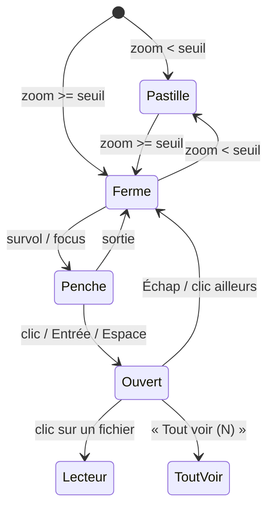

# Niveau 2 — Détail Fonctionnalité : DN-2 — Le dossier de verre sur la carte

**Parent** : L1n-dossier-du-noeud.md · **Maturité** : complet

> Projet : Gestionnaire_idées · Basé sur : L1n-dossier-du-noeud.md (D1, D3, D5, D6), référence « Glass Folder Cards »
> Date : 2026-10-12

## 1. Objectif de la fonctionnalité
Dessiner, à côté de chaque nœud qui a des fichiers rangés (DN-1), un dossier de verre flottant relié au nœud : fermé
au repos, il s'entrouvre au survol et s'ouvre au clic en éventail des 4 fichiers les plus récents. Il se déplace, garde
sa place, et se réduit en pastille quand la carte est dézoomée.

## 2. Use Cases précis

### UC-1 : Le dossier apparaît
- **Acteur :** l'app.
- **Déclencheur :** le rangement d'un nœud passe de 0 à 1 fichier (ou la carte se charge).
- **Scénario nominal :**
  1. Le dossier naît **à côté du nœud** (côté libre, comme les documents de la spec 012 D4 : en dessous par défaut,
     décalé s'il y a un plan d'attaque ou une carte de structure), relié par un **lien fin**.
  2. Il s'assemble (entrée animée du composant : panneau arrière, fichiers, verre) au premier affichage.
  3. Étiquette : titre du nœud (tronqué) ; seconde ligne : « 3 fichiers ».
- **Scénarios alternatifs :**
  - Animations réduites → apparition sans mouvement.
  - Le nœud est replié dans son plan, ou dans une autre vue (Progression / Workflow / Architecture) → le dossier suit
    la visibilité de son nœud.
- **Post-condition :** un nœud « dossier » sur la carte, relié à son nœud.

### UC-2 : Survoler, ouvrir, fermer
- **Acteur :** mentalyas (souris ou clavier).
- **Scénario nominal :**
  1. Survol ou focus → le verre bascule vers soi, les fichiers remontent un peu ; reflet et parallaxe suivent le
     pointeur (sans rerendu React).
  2. Clic, Entrée ou Espace → ouvert : éventail des 4 fichiers les plus récents (documents d'abord), chacun un bouton
     à son nom et sa sorte (« MD · 9 Ko », « TS · 120 lignes ») ; pastille « nouveau » le cas échéant.
  3. Sous l'éventail : **« Tout voir (N) »** (DN-3) quand N > 4, toujours présent sinon.
  4. Échap, ou clic ailleurs → refermé, le focus revient au dossier.
- **Scénarios alternatifs :**
  - Clic sur un fichier de l'éventail → il s'ouvre dans le lecteur, dans l'onglet du nœud du panneau de droite
    (comme les fichiers d'élément aujourd'hui).
  - Un seul fichier → éventail d'une feuille, centrée.
- **Post-condition :** l'ouverture marque les fichiers « vus » (R5 de DN-1).

### UC-3 : Déplacer, garder sa place
- **Scénario nominal :** glisser le dossier (par son bord, pas par un fichier) ; sa position relative au nœud est
  gardée en base ; il suit son nœud quand celui-ci bouge.
- **Scénario alternatif :** « Réorganiser » replace les dossiers jamais déplacés à la main.

### UC-4 : Dézoomer
- **Scénario nominal :** sous un seuil de zoom, le dossier se réduit en **pastille « 📁 N »** posée sur le nœud ; au
  dessus, il redevient dossier. Un clic sur la pastille recentre et zoome sur le dossier.
- **Post-condition :** la vue d'ensemble reste lisible ; aucun verre dépoli calculé au loin.

### UC-5 : Illustration du panneau arrière
- **Scénario nominal :** encre liquide générée (marbre ou traîne), palette tirée de la **couleur du nœud** (module
  pour un élément, catégorie pour une idée, couleur de l'étape), arrangement tiré de son identifiant ; peinte une fois
  par petits morceaux (quelques millisecondes par image), gardée en cache pour la session.
- **Scénario alternatif :** thème clair → verre laiteux ; thème sombre ou carbone → verre fumé (jeton `--color-surface`,
  comme les schémas Mermaid).

## 3. Workflow (Mermaid)

## 4. Règles métier
| # | Règle | Justification |
|---|-------|----------------|
| R1 | Un dossier par nœud, jamais vide | D1 |
| R2 | Éventail : 4 fichiers au plus, documents d'abord, puis du plus récent au plus ancien | D3 ; un document de Claude est ce qu'on vient chercher |
| R3 | Couleurs et ombres aux jetons du thème ; le CSS du composant est réécrit (pas de `<style>` embarqué par instance) | Règles CSS du dépôt ; 30 dossiers = 30 copies du même CSS sinon |
| R4 | Accessibilité : le dossier est un bouton (`aria-expanded`), les fichiers une liste de boutons, fermés hors de la tabulation (`inert`) ; axe sans violation | Règles du dépôt (WCAG AA) |
| R5 | Animations réduites : aucun mouvement, aucune parallaxe | Réglage de l'app et préférence système |
| R6 | Au loin, pastille sans verre dépoli ni illustration | Performance (L1n question 2) |
| R7 | Le dossier ne mange pas les gestes de la carte : glisser la carte depuis le dossier fermé reste possible | Habitude de React Flow dans l'app |

## 5. Critères d'acceptation (Definition of Done)
- [ ] Un nœud avec 1 fichier rangé montre un dossier relié ; à 0, plus de dossier.
- [ ] Survol, ouverture, fermeture (souris et clavier) conformes à la référence ; Échap referme et rend le focus.
- [ ] Un clic sur un fichier l'ouvre dans le lecteur du panneau de droite.
- [ ] Position gardée après relance ; le dossier suit son nœud.
- [ ] Pastille « 📁 N » sous le seuil de zoom.
- [ ] Illustration aux couleurs du nœud, thème clair et sombre ; animations réduites respectées.
- [ ] Mesure : 30 dossiers à l'écran, déplacement et zoom de la carte fluides (seuil à fixer au niveau 3).
- [ ] Tests renderer + `expectNoAxeViolations` ; e2e avec capture.

## 6. Signal de complexité — Niveau 3 nécessaire ?
| Critère | Présent ? | Détail |
|---------|-----------|--------|
| Logique métier complexe (calculs, machine à états) | Oui | États repos / penché / ouvert / pastille ; placement à côté du nœud selon la vue |
| Intégration API tierce | Non | Composant réécrit, sans dépendance |
| Données sensibles (paiement/santé/légal) | Non | — |
| Accès multi-rôles / permissions différenciées | Non | — |

**Recommandation :** Niveau 3 utile pour la performance (verre dépoli et illustrations nombreux, budget par image) et
le placement dans `buildGraph` (trois vues de la carte) ; le reste tient au niveau 2.
