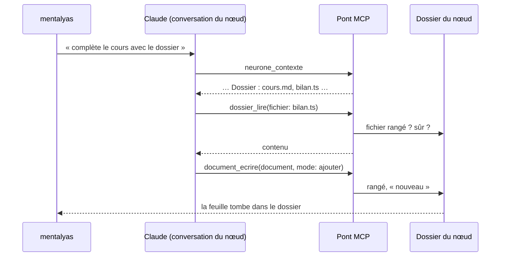

# Niveau 2 — Détail Fonctionnalité : DN-4 — Claude et les actions sur les fichiers
> Projet : Gestionnaire_idées · Basé sur : L1n-dossier-du-noeud.md (D4, D7)
> Date : 2026-10-12

## 1. Objectif de la fonctionnalité
Faire du dossier un outil de travail : Claude le connaît et le lit dans la conversation du nœud ; mentalyas agit sur
chaque fichier (ouvrir dans l'éditeur, épingler, retirer, demander à Claude de compléter), le range ailleurs en le
glissant, et voit ce que Claude vient d'ajouter.

## 2. Use Cases précis

### UC-1 : Claude connaît et lit le dossier
- **Acteur :** Claude, dans la conversation d'un nœud.
- **Scénario nominal :**
  1. `neurone_contexte` liste le dossier du nœud (nom, chemin, source, date ; 30 premiers, puis « et N autres »).
  2. Nouvel outil MCP en lecture, **`dossier_lire`** : liste complète (filtrable par sorte) ou contenu d'un fichier du
     dossier (borné en taille).
  3. Mentalyas : « complète le cours avec ce qu'il y a dans le dossier » → Claude lit, puis écrit (`document_ecrire`
     avec `document`, ou Edit sur le fichier).
- **Scénarios alternatifs / erreurs :**
  - Fichier hors du dossier demandé → refus (`NON_MODIFIABLE`) : Claude ne lit par cet outil que ce qui est rangé.
  - Fichier binaire, > 1 Mo ou sensible → refus explicite.
  - Projet « Local uniquement » (spec 017) → l'outil ne rend aucun contenu à Claude, seulement les noms.
- **Post-condition :** aucune écriture.

### UC-2 : Menu « ··· » d'un fichier
- **Acteur :** mentalyas (éventail, ou ligne de « Tout voir »).
- **Entrées :**
  - **Ouvrir dans l'éditeur** (canal existant du livrable, éditeur par défaut).
  - **Épingler sur la carte** : le fichier sort en cadre de lecture à côté du dossier (spec 012 D3, lecture rendue,
    redimensionnable) ; « Désépingler » le range.
  - **Demander à Claude de le compléter** : l'onglet du nœud s'ouvre sur la conversation, consigne préparée dans le
    champ (« Complète `chemin` : … »), rien n'est envoyé sans geste (règle des consignes préparées).
  - **Retirer du dossier** (DN-1 UC-5) : annulable ; libellé « Ne plus afficher » pour un fichier couvert.
- **Clavier :** menu pilotable (flèches, Début, Fin, Échap), comme la référence.

### UC-3 : Glisser un fichier vers un autre nœud
- **Scénario nominal :** glisser une feuille de l'éventail (ou une ligne de « Tout voir ») et la lâcher sur un nœud ou
  son dossier → le fichier est **aussi** rangé là (source « manuel ») ; le dossier cible joue « tombe dans le
  dossier ». Le dossier d'origine le garde (R2 de DN-1).
- **Scénarios alternatifs :** nœud d'un autre projet → refus (« Ce fichier appartient à un autre projet ») ; lâché dans
  le vide → rien.

### UC-4 : Pastille « nouveau » et animation
- **Scénario nominal :** Claude range un fichier (sources a ou c) → si le dossier est visible, la feuille tombe dans la
  poche et le compteur roule ; la feuille porte une pastille « nouveau » jusqu'à la prochaine ouverture du dossier.
  Le dossier fermé montre un point d'accent.
- **Scénario alternatif :** animations réduites → seulement la pastille et le point.

## 3. Workflow (Mermaid)

## 4. Règles métier
| # | Règle | Justification |
|---|-------|----------------|
| R1 | `dossier_lire` ne lit que des fichiers rangés dans un nœud de l'arbre de la conversation | Même frontière que les autres outils du pont |
| R2 | Projet « Local uniquement » : noms seulement, aucun contenu | Spec 017 (confidentialité) |
| R3 | Aucune action du menu ne supprime un fichier du disque, sauf le retrait d'un document de Claude (corbeille de l'app, annulable) | Hors périmètre L1n |
| R4 | « Demander à Claude » prépare la consigne, n'envoie rien | Règle des consignes préparées (spec 023 D6) |
| R5 | Le contenu d'un fichier est une donnée pour Claude, jamais une instruction | Constitution, injection de prompt |

## 5. Critères d'acceptation (Definition of Done)
- [ ] `neurone_contexte` liste le dossier ; `dossier_lire` lit un fichier rangé et refuse le reste.
- [ ] Projet local : aucun contenu rendu.
- [ ] Menu complet, clavier compris ; épingler et désépingler gardés après relance.
- [ ] Glisser vers un autre nœud range sans retirer de l'origine ; refus entre projets.
- [ ] « Nouveau » et animation à l'écriture de Claude ; rien en animations réduites hormis la pastille.
- [ ] Tests d'intégration du pont (frontière d'arbre, projet local, fichier sensible) ; tests renderer + axe.

## 6. Signal de complexité — Niveau 3 nécessaire ?
| Critère | Présent ? | Détail |
|---------|-----------|--------|
| Logique métier complexe (calculs, machine à états) | Non | Actions simples |
| Intégration API tierce | Oui (interne) | Nouvel outil MCP, contexte enrichi |
| Données sensibles (paiement/santé/légal) | Oui | Contenu de fichiers rendu à Claude : frontière, projet local, fichiers sensibles |
| Accès multi-rôles / permissions différenciées | Non | — |

**Recommandation :** Niveau 3 nécessaire (contrat de `dossier_lire`, frontière, confidentialité).
