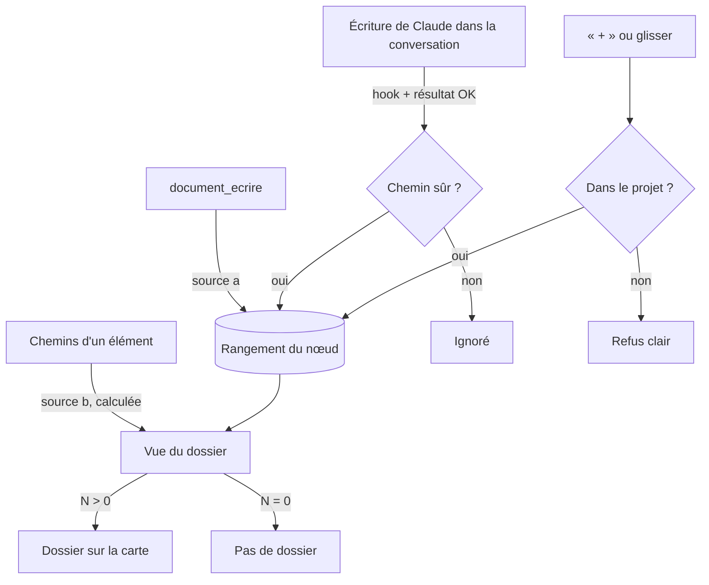

# Niveau 2 — Détail Fonctionnalité : DN-1 — Le rangement (quels fichiers dans quel dossier)
> Projet : Gestionnaire_idées · Basé sur : L1n-dossier-du-noeud.md (D1, D2, D7, Sécurité)
> Date : 2026-10-12

## 1. Objectif de la fonctionnalité
Tenir, pour chaque nœud, la liste des fichiers de son porte-documents : d'où vient chaque fichier (document de Claude,
fichier couvert par le nœud, écrit en conversation, ajouté à la main), quand il est entré, s'il est nouveau. C'est le
socle de toutes les autres fonctionnalités : le dossier n'existe sur la carte que si cette liste n'est pas vide (D1).

> Analogie : la fiche de prêt d'une bibliothèque. Les livres (fichiers) restent sur leurs étagères (le disque) ; le
> rangement note seulement quel livre est dans quel carton (nœud), qui l'y a mis et quand.

## 2. Use Cases précis

### UC-1 : Claude rédige un document pour un nœud (source a)
- **Acteur :** Claude, depuis la conversation d'un nœud (ou mentalyas via « Rédiger un document »).
- **Déclencheur :** appel `document_ecrire` (sans `document`).
- **Scénario nominal :**
  1. L'app crée le `.md` (spec 012 D1 : `docs/brainstormer/` du projet lié, sinon `documents` du profil).
  2. Elle range le document dans le dossier du nœud, source « document », marqué « nouveau ».
  3. Le dossier apparaît sur la carte s'il n'existait pas (DN-2), l'animation « tombe dans le dossier » joue.
- **Scénarios alternatifs / erreurs :**
  - Nœud d'un autre arbre que la conversation → refus (règle actuelle du pont, inchangée).
  - Nœud archivé ou absorbé → refus clair.
- **Post-condition :** une ligne de rangement, un fichier sur le disque, un lot d'Historique annulable.
- **Change par rapport à aujourd'hui :** `document_ecrire` accepte **tout nœud** (éléments, nœuds Workflow), plus
  seulement genesis et étapes (correctif du 2026-10-12 levé).

### UC-2 : Le nœud couvre déjà des fichiers (source b)
- **Acteur :** l'app.
- **Déclencheur :** un élément de carte de structure a des chemins (`structure_dessiner`, ajout de chemin).
- **Scénario nominal :**
  1. Les chemins de l'élément sont développés en fichiers du projet (règle actuelle de « Fichiers », spec 017 US7).
  2. Ces fichiers apparaissent dans le dossier, source « couvert », **sans être copiés dans la table** : ils sont
     calculés à la lecture (les chemins changent, le disque aussi).
- **Scénarios alternatifs / erreurs :**
  - Chemin disparu du disque → absent du dossier, sans erreur.
  - Plus de 200 fichiers → la liste est tronquée comme aujourd'hui, « Tout voir » le signale.
- **Post-condition :** aucune écriture ; le compteur du dossier inclut ces fichiers.

### UC-3 : Claude écrit un fichier dans la conversation d'un nœud (source c)
- **Acteur :** Claude (Write, Edit… dans la conversation).
- **Déclencheur :** hook `ecriture_avant`, puis résultat réussi de l'outil (mécanisme existant, spec 014 R5).
- **Scénario nominal :**
  1. Le chemin écrit est vérifié (sous le dossier du projet lié, pas de `..`, pas de fichier sensible).
  2. Écriture réussie → le fichier est rangé dans le dossier du nœud de la conversation, source « conversation »,
     marqué « nouveau ». Déjà rangé → sa date de mise à jour change, il repasse « nouveau ».
- **Scénarios alternatifs / erreurs :**
  - Écriture refusée ou échouée → rien n'est rangé.
  - Fichier hors du projet, binaire, sensible (`.env`…) → pas rangé (règle actuelle du suivi).
  - Conversation d'un élément → comme aujourd'hui, le chemin rejoint aussi les chemins de l'élément.
  - Conversation d'une action finale → il rejoint aussi le livrable (spec 013), inchangé.
- **Post-condition :** une ligne de rangement par fichier distinct.

### UC-4 : Mentalyas ajoute un fichier à la main (source d)
- **Acteur :** mentalyas.
- **Déclencheur :** « + » du dossier (sélecteur de fichier limité au projet), ou glisser depuis « Tout voir » ou
  l'explorateur, ou glisser un fichier d'un autre dossier (DN-4).
- **Scénario nominal :** le main vérifie le chemin (même garde), range le fichier source « manuel ».
- **Scénarios alternatifs / erreurs :**
  - Fichier hors du projet lié (ou nœud sans projet lié) → refus : « Seuls les fichiers du projet peuvent être rangés ».
  - Déjà dans ce dossier → rien ne change.
- **Post-condition :** une ligne de rangement ; le fichier n'est ni copié ni déplacé.

### UC-5 : Retirer un fichier du dossier
- **Acteur :** mentalyas (menu « ··· », DN-4).
- **Scénario nominal :** la ligne de rangement est retirée ; **le fichier reste sur le disque** ; annulable.
- **Scénarios alternatifs :**
  - Fichier « couvert » (source b) → il ne peut pas être retiré du dossier sans changer les chemins de l'élément :
    l'action propose « Ne plus afficher dans le dossier » (masqué, réversible).
  - Document de Claude → retiré du dossier = document retiré (spec 012, annulable, le fichier part à la corbeille de
    l'app comme aujourd'hui).
- **Post-condition :** dossier vide → il disparaît de la carte (D1).

## 3. Workflow (Mermaid)

## 4. Règles métier
| # | Règle | Justification |
|---|-------|----------------|
| R1 | Un fichier = un chemin relatif au projet lié (ou au dossier `documents` du profil pour un document sans projet) | Même garde que le lecteur actuel ; jamais de chemin absolu en base |
| R2 | Un même fichier peut être dans plusieurs dossiers | Un cours peut servir à deux éléments (D7 c) |
| R3 | Un fichier n'apparaît qu'une fois dans un dossier, avec la source la plus forte : document > manuel > conversation > couvert | Pas de doublon dans l'éventail |
| R4 | Rien n'est copié ni déplacé sur le disque | Le dossier range, il ne gère pas (hors périmètre L1n) |
| R5 | « Nouveau » = entré ou modifié par Claude après la dernière ouverture du dossier par mentalyas | D7 d |
| R6 | Le rangement suit l'annulation : annuler l'écriture de Claude retire le fichier du dossier s'il n'existait pas avant | Constitution : tout ce que Claude écrit est annulable |
| R7 | Un nœud archivé garde son rangement (restauration possible) ; il n'est plus montré | Comme les autres données d'un nœud |

## 5. Critères d'acceptation (Definition of Done)
- [ ] `document_ecrire` sur un élément de structure crée le document et le range dans le dossier de l'élément.
- [ ] Un fichier écrit par Claude dans la conversation d'une étape (hors action finale) est rangé dans le dossier de l'étape.
- [ ] Les fichiers couverts par un élément apparaissent sans écriture en base, et suivent ses chemins.
- [ ] « + » refuse un fichier hors projet, avec un message clair ; accepte un fichier du projet sans le copier.
- [ ] Retirer un fichier ne touche jamais le disque (hors document de Claude, qui suit la spec 012) ; c'est annulable.
- [ ] Un dossier vide n'existe pas sur la carte.
- [ ] Tests : garde des chemins (`..`, lien symbolique, chemin absolu, `.env`), doublons, annulation.

## 6. Signal de complexité — Niveau 3 nécessaire ?
| Critère | Présent ? | Détail |
|---------|-----------|--------|
| Logique métier complexe (calculs, machine à états) | Oui | Quatre sources fusionnées, priorité de source, « nouveau », annulation |
| Intégration API tierce | Non | Hook interne existant |
| Données sensibles (paiement/santé/légal) | Oui (fichiers) | Chemins venus de Claude et de mentalyas : garde du main |
| Accès multi-rôles / permissions différenciées | Non | — |

**Recommandation :** Niveau 3 nécessaire (schéma de la table de rangement, migration, garde des chemins, annulation).
