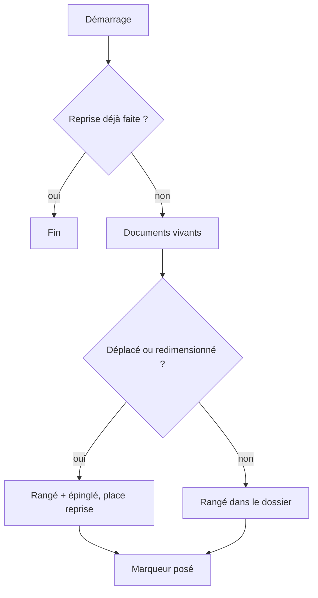

# Niveau 2 — Détail Fonctionnalité : DN-5 — Reprise des documents de la spec 012 dans les dossiers

**Parent** : L1n-dossier-du-noeud.md · **Maturité** : complet

> Projet : Gestionnaire_idées · Basé sur : L1n-dossier-du-noeud.md (D4), spec 012 (D3, D4, en pause)
> Date : 2026-10-12

## 1. Objectif de la fonctionnalité
Faire passer les nœuds documents existants (un nœud fichier par document, sous son genesis ou son étape) dans le
porte-documents de leur nœud, sans perte : mêmes fichiers, mêmes versions, même annulation ; seul leur rendu sur la
carte change. Un document peut être épinglé pour rester ouvert à côté du nœud.

## 2. Use Cases précis

### UC-1 : Premier démarrage après la mise à jour
- **Acteur :** l'app.
- **Scénario nominal :**
  1. Chaque document vivant (non retiré) devient une ligne de rangement de son nœud, source « document », date =
     création du document, **non « nouveau »**.
  2. Un document qui avait été **déplacé ou redimensionné** à la main est **épinglé** (sa place et sa taille sont
     reprises) : la carte de mentalyas ne change pas pour ce qu'il avait arrangé.
  3. Les autres disparaissent de la carte, rangés dans le dossier.
  4. Un marqueur (comme `migration.legacySheets`) évite de refaire la reprise.
- **Scénarios alternatifs / erreurs :**
  - Fichier du document introuvable sur le disque → rangé quand même (le lecteur propose « Recréer », spec 012).
  - Document retiré (corbeille) → pas rangé ; « Annuler » sa suppression le range.
- **Post-condition :** aucune donnée effacée ; tables des documents inchangées, rangement ajouté.

### UC-2 : Épingler, désépingler
- **Scénario nominal :** menu « ··· » → « Épingler sur la carte » : le document sort en cadre de lecture (spec 012 D3)
  à côté du dossier, relié à lui ; « Désépingler » le range. Place et taille gardées.

### UC-3 : Revenir en arrière
- **Scénario nominal :** la reprise est une migration avec son `down` (constitution) : retirer le rangement et les
  épingles rend la carte d'avant (les nœuds documents réapparaissent).

## 3. Workflow (Mermaid)

## 4. Règles métier
| # | Règle | Justification |
|---|-------|----------------|
| R1 | Aucun document, fichier ni version n'est supprimé | Données de mentalyas |
| R2 | Ce que mentalyas a arrangé à la main reste à sa place (épinglé) | Ne pas défaire son travail |
| R3 | Reprise idempotente (marqueur), réversible (`down` écrit à la main) | Constitution |
| R4 | La spec 012 est amendée (D3 : lecture dans le cadre épinglé ou le lecteur ; D4 : placement par le dossier) avant de coder | Méthode : amender la spec d'abord |

## 5. Critères d'acceptation (Definition of Done)
- [ ] Sur une base avec documents (dont un déplacé et un retiré), la reprise range, épingle et ignore comme prévu.
- [ ] Relancer l'app ne refait rien ; le `down` rend l'état d'avant.
- [ ] Versions, lecture, réécriture par Claude et annulation inchangées.
- [ ] Spec 012 amendée (décisions datées).
- [ ] Test d'intégration de la migration sur une base fictive.

## 6. Signal de complexité — Niveau 3 nécessaire ?
| Critère | Présent ? | Détail |
|---------|-----------|--------|
| Logique métier complexe (calculs, machine à états) | Oui | Reprise de données, épingles, idempotence |
| Intégration API tierce | Non | — |
| Données sensibles (paiement/santé/légal) | Non | Données de mentalyas, sans effacement |
| Accès multi-rôles / permissions différenciées | Non | — |

**Recommandation :** Niveau 3 nécessaire (migration et `down`, ordre au démarrage).
