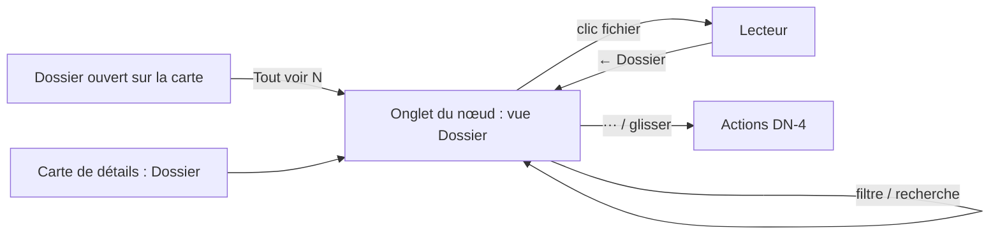

# Niveau 2 — Détail Fonctionnalité : DN-3 — « Tout voir » : le dossier entier dans le panneau de droite

**Parent** : L1n-dossier-du-noeud.md · **Maturité** : complet

> Projet : Gestionnaire_idées · Basé sur : L1n-dossier-du-noeud.md (D3), spec 027 (panneau de droite à onglets)
> Date : 2026-10-12

## 1. Objectif de la fonctionnalité
Parcourir tout le contenu d'un dossier, même large (120 fichiers d'un module), dans l'onglet du nœud du panneau de
droite : arborescence, filtre par sorte, recherche, et lecture d'un fichier dans le lecteur existant.

## 2. Use Cases précis

### UC-1 : Ouvrir « Tout voir »
- **Acteur :** mentalyas.
- **Déclencheur :** « Tout voir (N) » sous l'éventail du dossier ouvert, ou entrée « Dossier » de la carte de détails
  du nœud.
- **Scénario nominal :**
  1. L'onglet du nœud s'ouvre (ou s'affiche) dans le panneau de droite, sur sa vue **Dossier** (à côté de la
     conversation, comme le lecteur de fichier aujourd'hui).
  2. En tête : titre du nœud, compte par sorte (« 2 docs · 9 code · 1 autre »), filtre **Tout / Docs / Code / Autres**,
     champ de recherche.
  3. Arborescence par dossier du disque (`docs/`, `src/…`), repliable ; chaque fichier : nom, source (pastille
     « Claude », « conversation », « ajouté », « couvert »), date, « nouveau ».
- **Post-condition :** les fichiers affichés sont marqués « vus ».

### UC-2 : Lire un fichier
- **Scénario nominal :** clic → lecteur dans le même onglet (`.md` mis en forme avec bascule texte brut, code coloré et
  numéroté, symboles s'il est analysé) ; « ← Dossier » revient à la liste à la même place de défilement.
- **Scénarios alternatifs :** binaire ou > 1 Mo → message, bouton « Ouvrir dans l'éditeur ».

### UC-3 : Chercher, filtrer
- **Scénario nominal :** la recherche filtre par nom et chemin (pas le contenu au premier lot) ; le filtre par sorte se
  combine ; l'arborescence s'ouvre sur les résultats.
- **Scénario alternatif :** aucun résultat → « Aucun fichier ne correspond », bouton « Effacer ».

### UC-4 : Ranger depuis « Tout voir »
- **Scénario nominal :** « + Ajouter un fichier du projet » (même garde que DN-1 UC-4) ; menu « ··· » de chaque ligne
  (DN-4) ; glisser une ligne sur un nœud de la carte la range aussi dans son dossier.

## 3. Workflow (Mermaid)

## 4. Règles métier
| # | Règle | Justification |
|---|-------|----------------|
| R1 | Sortes : **Docs** = `.md`, `.txt`, `.pdf` ; **Code** = langages reconnus par le lecteur ; **Autres** = le reste | Filtre simple et prévisible |
| R2 | La vue Dossier vit dans l'onglet du nœud (spec 027), pas dans une nouvelle fenêtre | Un panneau, une source de vérité |
| R3 | Liste virtualisée au-delà de 200 lignes | Un module large ne doit pas figer le panneau |
| R4 | Rien n'est lu en entier pour lister : nom, taille, date seulement | Le contenu ne se lit qu'à l'ouverture |

## 5. Critères d'acceptation (Definition of Done)
- [ ] « Tout voir » ouvre la vue Dossier dans l'onglet du nœud, avec comptes par sorte.
- [ ] Filtre et recherche combinés ; arborescence repliable ; navigation au clavier.
- [ ] Lecture d'un fichier et retour à la liste à la même place.
- [ ] 500 fichiers : ouverture et défilement fluides.
- [ ] Tests renderer + axe.

## 6. Signal de complexité — Niveau 3 nécessaire ?
| Critère | Présent ? | Détail |
|---------|-----------|--------|
| Logique métier complexe (calculs, machine à états) | Non | Liste, filtre, lecteur existant |
| Intégration API tierce | Non | — |
| Données sensibles (paiement/santé/légal) | Non | Lecture via la garde existante |
| Accès multi-rôles / permissions différenciées | Non | — |

**Recommandation :** Niveau 2 suffisant.
