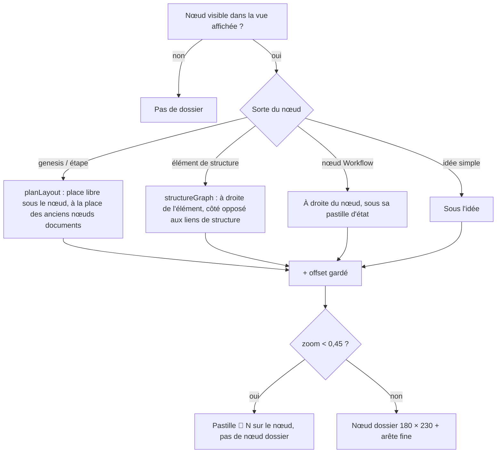
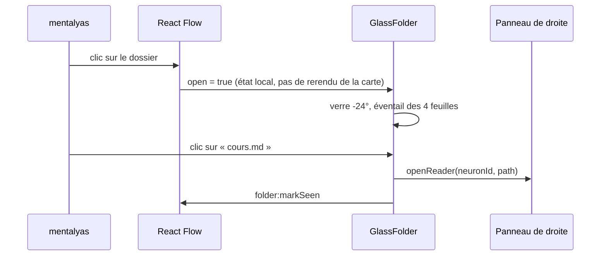

# Niveau 3 — Conception Technique : DN-2 — Le dossier de verre sur la carte

**Parent** : L2-dossier-carte.md · **Maturité** : complet

> Basé sur : L1n-dossier-du-noeud.md + L2-dossier-carte.md · Date : 2026-10-12
> Code de référence lu le 2026-10-12 : `buildGraph.ts` (plans, documents, vues de structure), `planLayout.ts`,
> `structureGraph.ts`, `IdeasCanvas.tsx`, `MermaidDiagram.tsx` (détection du thème sombre), référence
> « Glass Folder Cards » (21st.dev).

## 1. Contrat (vue de la carte et IPC)

| Élément | Forme | Note |
|---|---|---|
| `IdeasCanvasView.folders` (nouveau champ) | `readonly FolderBadge[]` : `{ neuronId, count, unseen, preview: FolderFileView[≤4], offset: {x,y}, moved }` | Calculé par le main avec la vue de la carte : un seul aller-retour IPC |
| `folder:move` (IPC) | `{ neuronId, x, y }` (bornés ±10 000) | Comme `document:move` aujourd'hui |
| Type de nœud React Flow | `'folder'`, id `folder:<neuronId>` | Arête fine `folder-link:<neuronId>` vers son nœud |
| Composant | `canvas/folder/GlassFolder.tsx` + `folder.css` | Réécriture de la référence : props `label`, `count`, `files`, `tone`, `palette`, `seed`, `open`, `onOpenChange`, `onFileSelect`, `onSeeAll`, `onAdd` |
| Illustration | `canvas/folder/folderArt.ts` | `createArtJob` et file de peinture partagée repris (fonctions pures testables), palette dérivée de la couleur du nœud |

## 2. Données
- Place : `folder_places` (DN-1). `offset` relatif à la **place par défaut** du dossier ; `moved = 1` dès un
  glissement (« Réorganiser » ne touche que `moved = 0`).
- Palette : 5 à 7 teintes générées depuis la couleur du nœud (HSL : éclaircie, assombrie, complémentaire sourde) ;
  `seed = hash(neuronId)`.

## 3. Placement (dans `buildGraph`)

## 4. Cas limites techniques et performance
- **Budget :** 30 dossiers visibles, glisser et zoomer la carte à 60 images/s sur le poste de mentalyas (mesure en
  e2e : durée des images pendant un glissement, comme les mesures SC-004/005 de la spec 017).
- **Verre dépoli** (`backdrop-filter: blur(22px)`) : coûteux quand la carte bouge. Pendant un glissement ou un zoom
  (`onMoveStart` / `onMoveEnd` de React Flow), un attribut `data-moving` sur la carte **coupe le flou** et rend la
  teinte opaque ; il revient à l'arrêt. Au-delà de 12 dossiers visibles, flou réduit (12 px).
- **Illustration :** taille réelle du dossier (~180 px de large) → toile de ~190 × 150 px, peinte en 3 à 5 images
  (7 ms par image, file partagée) ; cache par `(palette, seed, taille)` pour la session ; pas de peinture tant que le
  dossier est en pastille ou hors écran (`IntersectionObserver` sur le nœud).
- **Parallaxe :** propriétés CSS écrites dans une `requestAnimationFrame`, jamais d'état React ; désactivée pendant que
  la carte bouge et en animations réduites.
- **CSS :** une seule feuille `folder.css` (jetons du thème, pas de `<style>` par instance) ; couleurs du verre par
  jetons `--folder-glass`, `--folder-ink` dérivés de `--color-surface` et `--color-content`.
- **Gestes :** le dossier fermé laisse passer le glissement de la carte (classe `nodrag` seulement sur les feuilles et
  boutons quand il est ouvert) ; la molette ne zoome pas dans l'éventail.
- **Thème :** clair → verre laiteux ; sombre et carbone → verre fumé (même détection que `MermaidDiagram` : fond réel).

## 5. Sécurité spécifique
| Risque | Vecteur | Mitigation |
|---|---|---|
| Nom de fichier malveillant | balises dans un nom | Texte React, jamais d'HTML ; nom tronqué |
| Ressource externe | image de la référence (`image`, `href`) | Retirées de la réécriture : ni image distante ni lien ; un fichier s'ouvre par le lecteur de l'app |
| CSP | `<style>` embarqué, `clip-path: path()` | Feuille de style du bundle (CSP `style-src 'self'` suffit) ; `clip-path` est du CSS, sans risque |
| Licence | reprise du code 21st.dev dans un dépôt public | Vérifier la licence avant de reprendre du code ; sinon réécriture inspirée, sans copie (L1n question 1) |
