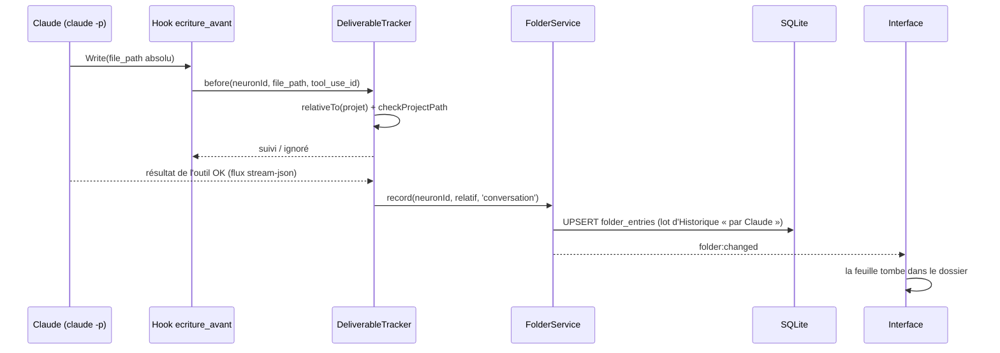
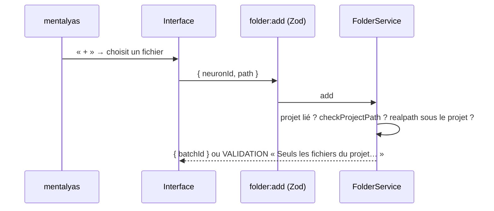

# Niveau 3 — Conception Technique : DN-1 — Le rangement

**Parent** : L2-dossier-rangement.md · **Maturité** : complet

> Basé sur : L1n-dossier-du-noeud.md + L2-dossier-rangement.md · Date : 2026-10-12
> Code de référence lu le 2026-10-12 : `schemaNeurons.ts` (`documents`, `document_versions`), `DocumentService`,
> `DocumentTools`, `DeliverableTracker` (hook `ecriture_avant`), `ElementRepository.addPath`, `checkProjectPath`,
> `HistoryService` (lots annulables), dernière migration `0046_reprise_edge_candidates`.

## 1. Contrat (IPC et service)

| Canal / méthode | Entrée (Zod) | Sortie | Erreurs |
|---|---|---|---|
| `folder:list` (IPC) | `{ neuronId: uuid }` | `FolderView` : `{ neuronId, files: FolderFileView[], counts: { docs, code, other }, truncated, unseen }` | `NOT_FOUND` (nœud absent ou archivé) |
| `folder:add` (IPC) | `{ neuronId: uuid, path: string ≤ 512 }` | `{ batchId }` | `VALIDATION` (chemin refusé), `NO_PROJECT` (nœud sans projet lié), `NOT_FOUND` |
| `folder:remove` (IPC) | `{ neuronId, path }` | `{ batchId }` | `NOT_FOUND`, `NOT_IN_FOLDER` |
| `folder:hide` / `folder:unhide` (IPC) | `{ neuronId, path }` | `{ batchId }` | idem (fichiers « couverts » seulement) |
| `folder:markSeen` (IPC) | `{ neuronId }` | `{ ok: true }` | `NOT_FOUND` |
| `FolderService.record(neuronId, path, source)` (main) | chemin relatif déjà vérifié | ligne créée ou mise à jour | — |
| `folder:changed` (diffusion main → interface) | `{ neuronId }` | — | — |

`FolderFileView` : `{ path, name, kind: 'doc'|'code'|'other', source: 'document'|'manual'|'conversation'|'covered', documentId?, size, updatedAt, unseen, pinned }`.
Le chemin affiché est **relatif** ; le chemin absolu ne quitte jamais le main.

## 2. Schéma de données détaillé

### Tables concernées
| Table | Colonnes | Contraintes | Index |
|---|---|---|---|
| `folder_entries` (nouvelle, migration `0047_folder_entries`) | `id` text PK · `neuron_id` text FK `neurons.id` · `root` text enum (`project`, `profile`) · `path` text (relatif, `/`) · `path_key` text (minuscules, pour l'unicité sous Windows) · `source` text enum (`document`, `manual`, `conversation`) · `document_id` text FK `documents.id` nullable · `hidden` integer 0/1 (fichier couvert masqué) · `pinned` integer 0/1 · `pin_x`, `pin_y`, `pin_w`, `pin_h` real nullable · `added_by` enum (`user`, `claude`) · `created_at`, `updated_at` · `seen_at` nullable · `deleted_at` nullable | `UNIQUE(neuron_id, root, path_key)` ; `source = 'document'` ⇔ `document_id` non nul (CHECK) | `folder_entries_neuron_idx(neuron_id)` ; `folder_entries_document_idx(document_id)` |
| `folder_places` (nouvelle, même migration) | `neuron_id` text PK FK · `offset_x`, `offset_y` real · `moved` integer 0/1 | — | — |
| `documents` (existante) | inchangée | — | — |

- Les fichiers **couverts** (source b) ne sont **pas** stockés : calculés à la lecture depuis les chemins de
  l'élément (`structure:files`). Une ligne n'existe pour eux que s'ils sont masqués (`hidden = 1`) ou épinglés.
- `down` (`migrations/down/0047_folder_entries.down.sql`) : `DROP TABLE folder_places; DROP TABLE folder_entries;`
  (les documents restent intacts, la carte retrouve les nœuds documents de la spec 012).

### Fusion des sources (lecture de `folder:list`)
1. Lignes vivantes de `folder_entries` (non retirées).
2. + fichiers couverts de l'élément (si `kind = 'element'`), moins ceux masqués.
3. Dédoublonnage par `path_key` : priorité `document > manual > conversation > covered` (R3 de DN-1).
4. Tri : documents d'abord, puis `updated_at` décroissant ; `unseen = updated_at > seen_at` pour les sources de Claude.
5. Taille et date lues sur le disque (`stat`), jamais le contenu ; plus de 500 entrées → `truncated`.

## 3. Diagrammes de séquence (Mermaid)

## 4. Cas limites techniques
- **Concurrence :** deux écritures de Claude sur le même fichier → `UPSERT` sur `(neuron_id, root, path_key)`, une
  seule ligne, `updated_at` le plus récent.
- **Idempotence :** `folder:add` d'un fichier déjà rangé → aucune écriture, `{ batchId: null }` ; `record` rejoué →
  même ligne.
- **Transactions / rollback :** document de Claude = création du document + ligne de rangement dans **la même
  transaction et le même lot** (annuler retire les deux) ; écriture de conversation = un lot par fichier, regroupé par
  tour de Claude comme les autres écritures.
- **Annulation (Historique) :** nouveau type d'entité `folder_entry` dans `HistoryService` (créé → retiré, retiré →
  restauré) ; annuler l'écriture d'un fichier par Claude **ne retire pas** le fichier du disque (ce n'est pas le
  rôle du rangement), seulement la ligne si elle avait été créée par cette écriture.
- **Volumétrie :** 500 entrées max par vue ; `stat` en parallèle borné ; résultat mis en cache par `neuronId` jusqu'à
  `folder:changed` ou retour du focus.
- **Fichier renommé hors de l'app :** la ligne pointe un chemin absent → montrée « introuvable » (grisée) dans
  « Tout voir », hors éventail ; « Retirer » la nettoie.

## 5. Sécurité spécifique
| Risque | Vecteur | Mitigation |
|---|---|---|
| Traversée de chemin | `path` avec `..`, absolu, lecteur Windows, UNC | `checkProjectPath` (existant) à l'entrée IPC et au `record` ; refus avant toute I/O |
| Lien symbolique sortant | fichier du projet lien vers `C:\Users\…` | `realpath` doit rester sous `realpath(projet)` (comme le lecteur actuel) |
| Fichier sensible exposé | `.env`, clés, `*.pem` | Liste de refus du suivi existante appliquée au rangement |
| Injection via nom de fichier | nom avec balises | Rendu texte React, jamais `innerHTML` |
| Saturation | Claude écrit 5 000 fichiers | Plafond de 500 lignes par dossier ; au-delà, journalisé (sans chemin complet), plus rien de rangé |
| Données personnelles en journal | chemins complets | Journaux : identifiant du nœud et compte seulement |
