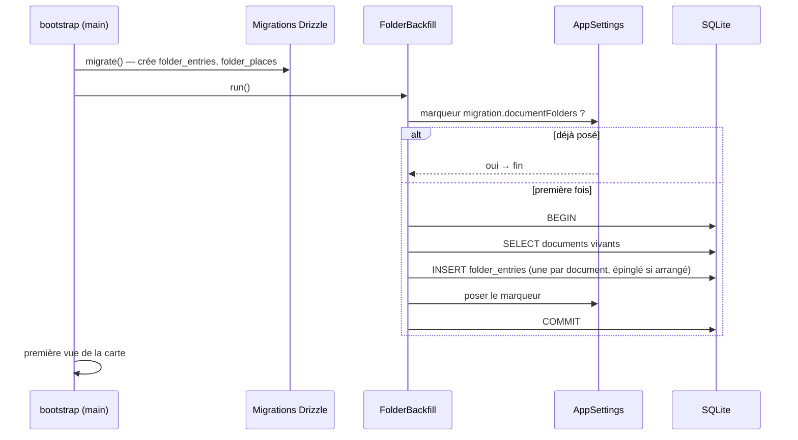

# Niveau 3 — Conception Technique : DN-5 — Reprise des documents de la spec 012

**Parent** : L2-dossier-reprise-012.md · **Maturité** : complet

> Basé sur : L1n-dossier-du-noeud.md + L2-dossier-reprise-012.md · Date : 2026-10-12
> Code de référence lu le 2026-10-12 : table `documents` (`width`, `height`, `offset_x`, `offset_y`, `deleted_at`),
> `DOCUMENT_DEFAULT_SIZE` (360 × 280), marqueur `migration.legacySheets` (reprise des tables archivées, spec 010).

## 1. Contrat
| Élément | Forme |
|---|---|
| Migration SQL `0047_folder_entries` | Crée `folder_entries`, `folder_places` (DN-1) ; **ne touche pas** `documents` |
| Reprise au démarrage `FolderBackfill.run()` (main, après les migrations, avant la première vue de la carte) | Lit les documents vivants, écrit les lignes de rangement, pose le marqueur `migration.documentFolders` dans les réglages de l'app |
| `down` | `migrations/down/0047_folder_entries.down.sql` : supprime les deux tables ; le marqueur est retiré par le même `down` (ligne de réglage) |
| Vue de la carte | `IdeasCanvasView.documents` ne porte plus que les documents **épinglés** ; les autres passent par `folders` |

## 2. Schéma de données (correspondances)
| Document (avant) | Ligne `folder_entries` (après) |
|---|---|
| `id`, `neuron_id` | `document_id = id`, `neuron_id = neuron_id`, `source = 'document'` |
| `folder` (`project` / `profile`), `file_name` | `root = folder`, `path = 'docs/brainstormer/' + file_name` (projet) ou `file_name` (profil) |
| `origin` | `added_by = origin` |
| `created_at` | `created_at`, `updated_at` (date de la version courante si plus récente) ; `seen_at = updated_at` (pas « nouveau ») |
| `offset_x ≠ 0` ou `offset_y ≠ 0` ou taille ≠ 360 × 280 | `pinned = 1`, `pin_x/y` = place absolue calculée comme aujourd'hui, `pin_w/h = width/height` |
| `deleted_at` non nul | pas de ligne (une restauration future range le document, comme une création) |

## 3. Diagramme de séquence (Mermaid)

## 4. Cas limites techniques
- **Idempotence :** marqueur + `INSERT OR IGNORE` sur `UNIQUE(neuron_id, root, path_key)` : une reprise interrompue
  puis relancée ne double rien.
- **Transaction :** toute la reprise dans une transaction ; échec → rien n'est écrit, l'app démarre avec les nœuds
  documents d'avant (vue de repli : documents non rangés affichés comme aujourd'hui) et l'erreur est journalisée sans
  contenu.
- **Volumétrie :** quelques centaines de documents au plus ; une seule requête de lecture, insertions préparées.
- **Place des épinglés :** recalculée à partir de la place d'annexe actuelle + offset, pour que l'écran ne bouge pas ;
  vérifiée en e2e par capture avant / après sur le profil démo.
- **Profil démo :** `npm run seed:demo` crée directement des dossiers (pas de reprise à faire) ; le seed reset reste
  valable.
- **Profil réel :** sauvegarder la base (`-wal`, `-shm`) avant le premier lancement de la version (règle apprise le
  2026-10-12).

## 5. Sécurité spécifique
| Risque | Vecteur | Mitigation |
|---|---|---|
| Perte de données | erreur de reprise | Aucune suppression ; transaction ; `down` ; sauvegarde conseillée |
| Chemin forgé en base | `file_name` modifié à la main | Repassé par `checkProjectPath` à la lecture, comme tout chemin rangé |
