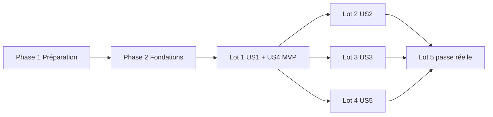

# Tasks: Conversation en panneau fixe (spec 027)

**Input**: `specs/027-panneau-conversation/` (spec.md, plan.md, research.md, data-model.md, contracts/side-panel.md,
quickstart.md)

**Tests**: demandés (constitution V, plan « Testing ») : règles pures, renderer + axe, intégration du réglage, e2e par
lot. Nommage `should_<comportement>_when_<condition>`.

**Organisation**: les lots du plan suivent les user stories. US1 et US4 forment le lot 1 (MVP) : le Dépôt doit devenir
un onglet dès que `SidePanel` remplace `RepoPanel` dans `IdeasPage`.

## Format : `[ID] [P?] [Story] Description`

- **[P]** : parallélisable (fichier différent, aucune dépendance sur une tâche non finie)
- **[Story]** : user story de la spec (US1 à US5)

---

## Phase 1 : Préparation

- [X] T001 Reporter les amendements dans `specs/022-noeuds-vivants/spec.md` : D6 et D10 (plus d'étirement de droite,
      renvoi à la spec 027 D1), D28 (l'épingle ne sert plus qu'à garder une carte ouverte, renvoi à 027 D2), chacun daté
      du 2026-10-11
- [X] T002 [P] Relever les sélecteurs qui visent la conversation ou le lecteur dans la carte de détails (« Discuter »,
      champ « Message à Claude », « ← Conversation », lecteurs) dans `tests/unit/renderer/{canvas-create,
      canvas-keyboard, document-node, living-foundations, plan-ghosts, project-manager, workflow-card,
      workflow-view, git-panel}.test.tsx` et `tests/e2e/*.e2e.ts` ; noter la liste en tête de la phase 3 (commentaire
      dans ce fichier) pour la mise à jour de T020 et T021

---

## Phase 2 : Fondations (bloquant)

**But** : le magasin des onglets, ses règles pures et la demande de centrage, utilisés par toutes les stories.

- [X] T003 Écrire les tests des transitions pures dans `tests/unit/renderer/side-panel-store.test.ts` (ils échouent
      d'abord) : ouvrir un onglet `chat` sans doublon et l'afficher ; ouvrir `workflowChat` ; `openReader` sur un onglet
      existant ou nouveau (`neuronId` `null`) ; `closeReader` revient à la conversation ou ferme un onglet sans
      conversation ; `close` de l'onglet affiché affiche le voisin de droite, sinon de gauche, sinon `null` ;
      `openRepo` / `closeRepo` (clé `repo:<genesisId>`, un seul onglet Dépôt) ; `closeMissing` ne ferme que les onglets
      `chat` absents ; `reset` ; `requestFocus` donne un nonce nouveau à chaque appel ; titre tronqué à 200 caractères
- [X] T004 Créer `src/renderer/src/canvas/side/sidePanelStore.ts` : types `SideTab` (`chat`, `workflowChat`, `repo`),
      `TabReader` (`ReaderTarget` existant + `deliverableNeuronId`, `elementId`, `genesisId`, `document`),
      `SidePanelState` (`tabs`, `shownKey`, `focus`) ; transitions pures exportées (data-model.md) ; magasin zustand qui
      les applique ; sélecteurs `shownTab`, `shownNodeId`, `repoGenesisId` (contrat `contracts/side-panel.md`)

**Checkpoint** : T003 vert.

---

## Phase 3 : US1 + US4 — le panneau et le Dépôt en onglet (P1/P2) 🎯 MVP (lot 1)

**But** : la conversation, le lecteur et le Dépôt s'affichent dans un panneau fixe à droite, hors du zoom de la carte.

**Test indépendant** : quickstart 1, 4, 6.

### Tests

- [X] T005 [P] [US1] Tests renderer + axe de `SidePanel` dans `tests/unit/renderer/side-panel.test.tsx` : rien rendu
      sans onglet ; `aside` « Panneau de droite » ; onglet `chat` → `ChatPanel` et en-tête (titre, sorte) ; onglet
      `repo` → contenu du Dépôt ; lecteur → « ← Conversation » ; Échap dans le lecteur revient à la conversation, puis
      rend le focus à `.react-flow__pane` ; Échap ne ferme jamais d'onglet ; `expectNoAxeViolations`
- [X] T006 [P] [US1] Tests des façades de `uiStore` dans `tests/unit/renderer/side-panel.test.tsx` (bloc « façades ») :
      `openChat(neuronId)`, `navigate` « plonger maintenant », `openViewer`, `openRepo`, `closeRepo`, `repoGenesisId`
      passent par `sidePanelStore` (titre lu dans la vue en cache, sinon « Conversation »)

### Implémentation

- [X] T007 [US1] Créer `src/renderer/src/canvas/side/SideTabs.tsx` : `tablist` « Onglets du panneau », un `tab` par
      onglet (titre en texte), bouton × « Fermer l'onglet « titre » » hors du `tab` ; clic = `show(key)`
- [X] T008 [US1] Créer `src/renderer/src/canvas/side/ChatTabContent.tsx` : en-tête (titre, sorte), `ChatPanel`
      inchangé (même `draftKey` qu'aujourd'hui), ou le lecteur du `TabReader` (`FileViewer`, `ElementFileReader`,
      `WorkflowFileReader`, `DocumentReader`) avec « ← Conversation » ; onglet sans conversation : lecteur seul, son ✕
      ferme l'onglet
- [X] T009 [US1] Créer `src/renderer/src/canvas/side/WorkflowChatTabContent.tsx` : requête `workflow:chat` existante
      (clé `['workflow-chat', key]`, reprise de `WorkflowCard.tsx`), puis `ChatPanel` avec `draftKey = nodeId` ; lecteur
      `WorkflowFileReader`
- [X] T010 [US1] Créer `src/renderer/src/canvas/side/SidePanel.tsx` et `src/renderer/src/canvas/side/side.css` :
      `aside` fixe à 38 % (largeur min 360 px, jetons du thème, bordure gauche comme `RepoPanel`), `SideTabs`, puis
      le contenu de l'onglet affiché (`role="tabpanel"`) : `ChatTabContent`, `WorkflowChatTabContent` ou `RepoPanel` ;
      Échap selon R9
- [X] T011 [US4] Adapter `src/renderer/src/git/RepoPanel.tsx` : retirer l'enveloppe `<aside>` (largeur, bordure) ; son
      ✕ appelle `sidePanelStore.closeRepo()` ; contenu inchangé ; mettre à jour `tests/unit/renderer/git-panel.test.tsx`
- [X] T012 [US1] Retirer `side`, `reader`, `setSide` et l'option `side` d'`openCard` dans
      `src/renderer/src/canvas/cards/cardsStore.ts` (et leurs tests unitaires s'il y en a)
- [X] T013 [US1] Retirer l'étirement de droite de `src/renderer/src/canvas/cards/DetailCard.tsx` (prop `side`, rendu
      de la conversation et du lecteur) ; « Discuter » appelle `onChat`, avec `aria-pressed` quand l'onglet du nœud est
      affiché ; retirer les styles de l'étirement dans `src/renderer/src/canvas/cards/cards.css`
- [X] T014 [US1] Brancher `src/renderer/src/canvas/cards/IdeaCards.tsx` : « Discuter » → `sidePanelStore.openChat`
      (titre et sorte du nœud, `neuronIdOf(subject)`) ; boutons de lecture → `openReader` (livrable, élément, document
      avec instantané `DocumentView`)
- [X] T015 [US1] Brancher `src/renderer/src/canvas/workflow/WorkflowCard.tsx` : `discussWorkflow` →
      `openWorkflowChat` (la consigne préparée reste dans `uiStore.chatDrafts[nodeId]`) ; lecteur de fichier de tâche →
      `openReader` ; retirer la requête `workflow:chat` déplacée en T009
- [X] T016 [US1] Façades dans `src/renderer/src/app/uiStore.ts` : `openChat`, `navigate` (plonger maintenant),
      `openViewer`, `openRepo`, `closeRepo`, `repoGenesisId` passent par `sidePanelStore` ; ils ouvrent aussi la carte du
      nœud (sans `side`) pour garder son contexte ; vérifier les appelants `RepoBadge.tsx`, `BrainstormBar.tsx`,
      `NewBrainstorm` et le raccourci `Ctrl+Maj+G`
- [X] T017 [US1] `src/renderer/src/pages/IdeasPage.tsx` : `SidePanel` à la place de `RepoPanel` (la carte garde au
      moins 62 % par défaut) ; `sidePanelStore.reset()` quand `brainstormId` change ; le panneau reste à côté de la vue
      de résolution des conflits
- [X] T018 [US1] `src/renderer/src/canvas/IdeasCanvas.tsx` : Échap sur le canevas ferme la carte active (plus de
      lecteur à replier) ; `closeMissing` avec l'ensemble des nœuds de la vue (toutes vues confondues : idées, étapes,
      éléments, documents, livrables), pas seulement les nœuds dessinés
- [X] T019 [US1] Vérifier la création d'un projet (spec 024) : la conversation du genesis s'ouvre dans le panneau,
      consigne préparée dans le champ (`src/renderer/src/home/` ou l'appelant de `uiStore.openChat` après création)

### Mise à jour des tests existants

- [X] T020 [US1] Mettre à jour les tests renderer listés en T002 (`canvas-create`, `canvas-keyboard`,
      `document-node`, `living-foundations`, `plan-ghosts`, `project-manager`, `workflow-card`, `workflow-view`) :
      la conversation et les lecteurs sont cherchés dans le panneau (monter `SidePanel` à côté, ou vérifier l'état de
      `sidePanelStore`)
- [X] T021 [US1] Mettre à jour les sélecteurs des e2e existants dans `tests/e2e/` (conversations, Workflow
      `workflow-task-files.e2e.ts`, widgets `widget-wireframe.e2e.ts`, Git `git-*.e2e.ts`, `project-manager.e2e.ts`,
      `run-project.e2e.ts`) : « détail de carte » → panneau
- [X] T022 [US1] Écrire `tests/e2e/side-panel.e2e.ts`, scénarios 1 (zoom 30 % et 150 %, « Recentrer »,
      « Tout afficher » : boîte du panneau identique), 4 (badge → onglet Dépôt, `Ctrl+Maj+G` le ferme) et 6 (lecteur,
      « ← Conversation », Échap) ; captures relues

**Checkpoint** : `npm run typecheck`, `npm run lint`, `npx prettier --check src tests`, `npm test`, `npm run e2e`
verts ; JOURNAL. MVP utilisable.

---

## Phase 4 : US2 — plusieurs conversations en onglets (P1) (lot 2)

**But** : plusieurs onglets avec leurs indicateurs et la navigation au clavier.

**Test indépendant** : quickstart 2.

- [X] T023 [P] [US2] Tests dans `tests/unit/renderer/side-panel-tabs.test.tsx` : deux onglets, le second affiché ;
      « ● Claude écrit » et « ⏸ attend ton accord » (texte caché lisible) d'après `useRunningChats` et
      `useWaitingChats` ; ←/→, Début/Fin déplacent le focus et affichent ; × de l'onglet affiché → voisin ; fermer la
      carte du nœud laisse l'onglet ; axe
- [X] T024 [US2] Déplacer `watchRunningChats()` de `src/renderer/src/canvas/workflow/useWorkflow.ts` vers
      `src/renderer/src/app/useMainEvents.ts` (écoute unique pour toute l'app) ; vérifier
      `tests/unit/renderer/workflow-view.test.tsx`
- [X] T025 [US2] Indicateurs, clavier (`aria-selected`, `aria-controls`, tabindex itinérant) et défilement horizontal
      de la barre dans `src/renderer/src/canvas/side/SideTabs.tsx` ; fermer un onglet n'interrompt aucun tour
- [X] T026 [US2] Compléter `tests/e2e/side-panel.e2e.ts`, scénario 2 (genesis + étape ①, « ⏸ » sur l'onglet non
      affiché et sur le nœud, × pendant un tour)

**Checkpoint** : tests et e2e verts ; JOURNAL.

---

## Phase 5 : US3 — retrouver le nœud de la conversation (P2) (lot 3)

**But** : l'anneau sur le nœud et « Centrer sur le nœud ».

**Test indépendant** : quickstart 3.

- [X] T027 [P] [US3] Tests dans `tests/unit/renderer/living-node-chat.test.tsx` : `data-chat="true"` sur le seul nœud
      de l'onglet affiché (et via `chatId` pour Workflow) ; l'anneau suit le changement d'onglet
- [X] T028 [P] [US3] Tests dans `tests/unit/renderer/side-panel-focus.test.tsx` : « Centrer sur le nœud » dépose
      `focus` ; le canevas appelle `setCenter` (durée 0 si animations réduites) ; nœud dans une autre vue →
      `setStructureView` puis centrage ; nœud introuvable → notification « Ce nœud n'est plus sur la carte »
- [X] T029 [US3] `src/renderer/src/canvas/living/LivingNode.tsx` : lire `shownNodeId` de `sidePanelStore`, poser
      `data-chat` ; anneau `--color-accent` hors du cercle dans `src/renderer/src/canvas/side/side.css`, distinct de
      `data-open`, du statut et de la pastille « ⏸ »
- [X] T030 [US3] Bouton « Centrer sur le nœud » dans `src/renderer/src/canvas/side/ChatTabContent.tsx` et
      `WorkflowChatTabContent.tsx` → `requestFocus(nodeId)`
- [X] T031 [US3] `src/renderer/src/canvas/IdeasCanvas.tsx` : effet sur `focus` (R5) : centre avec `timingFor('dive')`,
      ou bascule de vue (étape : `step.view` ; élément : Progression ; tâche : Workflow) puis centre au rendu suivant
- [X] T032 [US3] Compléter `tests/e2e/side-panel.e2e.ts`, scénario 3 (nœud hors écran, puis onglet d'une étape née en
      Workflow depuis la vue Progression)

**Checkpoint** : tests et e2e verts ; JOURNAL.

---

## Phase 6 : US5 — régler la largeur du panneau (P3) (lot 4)

**But** : poignée souris et clavier, largeur gardée, surimpression en fenêtre étroite.

**Test indépendant** : quickstart 5, 7.

- [X] T033 [P] [US5] Tests d'intégration dans `tests/integration/db/app-settings.test.ts` : `chatPanelWidth` vaut 38
      par défaut ; écrit puis relu ; 24, 56, 38.5 et une chaîne refusés par le schéma ; une valeur invalide en base
      retombe à 38
- [X] T034 [P] [US5] Tests renderer dans `tests/unit/renderer/side-panel-resize.test.tsx` : poignée `separator`
      (`aria-valuenow/min/max`) ; glisser borne entre 25 et 55 ; ←/→ par 2 % ; enregistrement au lâcher ou après
      400 ms sans touche ; sous 1 100 px, surimpression fermable ; axe
- [X] T035 [US5] `src/shared/ipc/app.ts` : `chatPanelWidth` dans `AppSettingsView`, le défaut et `AppSettingsPatch`
- [X] T036 [US5] `src/main/infrastructure/db/repositories/AppSettingsRepository.ts` : clé `ui.chatPanelWidth`,
      `z.number().int().min(25).max(55)`, valeur invalide → défaut ; `src/main/ipc/appHandlers.ts` : `SettingsPatch`
      accepte `chatPanelWidth` (schéma `strict`)
- [X] T037 [US5] Poignée et surimpression dans `src/renderer/src/canvas/side/SidePanel.tsx` et `side.css` : largeur
      lue des réglages, glisser (pointeur capturé), ←/→, écriture par `app:setSettings` au lâcher ou après 400 ms ;
      sous 1 100 px, position absolue avec ombre, 360 px minimum
- [X] T038 [US5] Compléter `tests/e2e/side-panel.e2e.ts`, scénarios 5 (50 % à la souris, → × 3 → 44 %, relance →
      44 %) et 7 (vue de 1 000 px)

**Checkpoint** : tests et e2e verts ; JOURNAL.

---

## Phase 7 : Passe réelle et finitions (lot 5)

- [X] T039 Vérifier les animations du panneau (ouverture, changement d'onglet, recentrage) avec « réduire les
      animations » (FR-013), dans `src/renderer/src/canvas/side/SidePanel.tsx`
- [X] T040 Rejouer le parcours de l'audit avec Claude réel (profil et coffre fictifs, scripts du scratchpad) :
      brainstorm → plan → étape → commit ; vérifier SC-001 à SC-005, captures dans `test-results/` (hors git)
- [X] T041 Mettre à jour `docs/JOURNAL.md`, le statut de `specs/027-panneau-conversation/spec.md` (« Livrée »),
      `CLAUDE.md` (Workflows actifs) et le tableau des priorités de `docs/AUDIT-2026-10-11-parcours-nouveau-projet.md`
- [X] T042 Vérifications avant commit (`npm run typecheck`, `npm run lint`, `npx prettier --check src tests`,
      `npm test`, `npm run e2e`), puis demander la confirmation du commit de la spec livrée

---

## Dépendances et ordre d'exécution

- Les lots 2, 3 et 4 ne dépendent que du lot 1 ; ils touchent tous `SidePanel` ou `ChatTabContent`, donc ils se font
  l'un après l'autre (ordre du plan : 2, 3, 4).
- Dans le lot 1 : T004 → T007 à T010 → T011 à T016 → T017, T018 → T019 → T020 à T022.
- T012 (retrait de `side`) casse la compilation de `DetailCard`, `IdeaCards`, `WorkflowCard` et `uiStore` : enchaîner
  T012 à T016 sans s'arrêter, puis lancer le typecheck.

## Parallélisme

- Phase 1 : T001 et T002.
- Lot 1 : T005 et T006 (tests) pendant T007 à T009 (fichiers nouveaux, indépendants).
- Lot 3 : T027 et T028 ; lot 4 : T033, T034, puis T035 et T036 (shared et main) en parallèle de T037.

## Stratégie

1. **MVP = lot 1** : le panneau existe, lisible à tout zoom, Dépôt compris ; un onglet à la fois suffit à lever le
   frein de l'audit. S'arrêter, vérifier par l'e2e et les captures.
2. Puis lots 2, 3 et 4, un e2e chacun.
3. Lot 5 : passe réelle, un seul commit pour la spec livrée (règle « un commit par module livré »).
